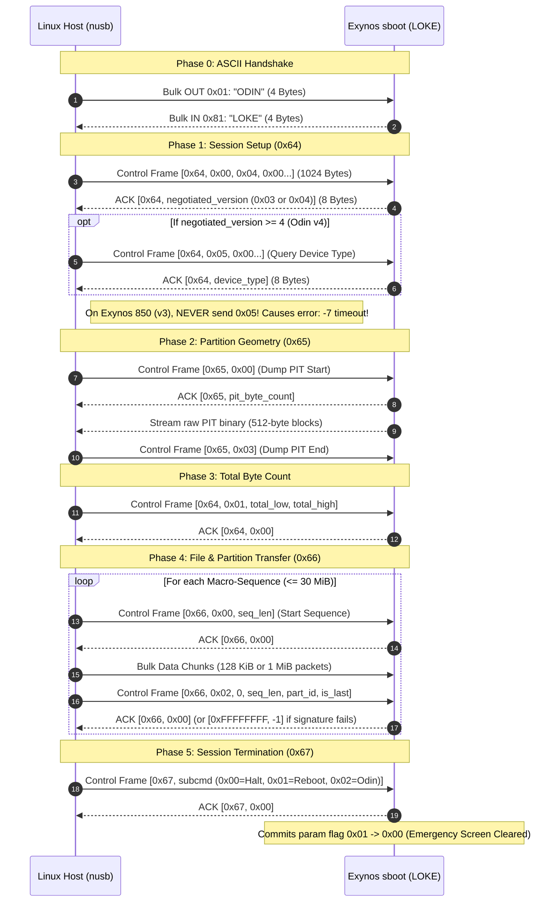

# Samsung LOKE Wire Protocol Specification (Odin v3 / v4)

**Document Version:** 3.0.0-NATIVE-PROTOCOL  
**Target Architecture:** GNU/Linux Host -> Samsung Exynos Bootloader (`sboot.bin` / LOKE)  
**Reference Target:** Samsung Galaxy A21s (`SM-A217F`, Exynos 850 / S5E3830)  
**Methodology:** Clean-room reverse engineering via **REA (Reverse Engineering Anything)**, Ghidra MCP static disassembly of `odin4` / `sboot.bin`, and live Linux `usbmon` wire captures.  
**License:** MIT

---

## 1. Overview & Clean-Room Architecture

Samsung Galaxy smartphones powered by Exynos System-on-Chips (SoCs) implement a proprietary firmware flashing interface inside their secondary bootloader (`sboot.bin`), known internally as **LOKE** (the device-side counterpart to Samsung's desktop **Odin** flashing protocol).

This document serves as the complete, authoritative clean-room wire protocol specification for implementing native Linux flashing utilities (e.g., using Rust `nusb`) without depending on reverse-engineered, leaked, or outdated binaries.

---

## 2. USB Transport Layer & Descriptors

| Parameter | Value | Details |
| :--- | :--- | :--- |
| **USB Vendor ID (`idVendor`)** | `0x04e8` | Samsung Electronics Co., Ltd. |
| **USB Product ID (`idProduct`)** | `0x685d` | Samsung Download Mode / LOKE Protocol |
| **Target Interface** | `Interface 1` | Vendor-Specific Bulk Data (Interface 0 is CDC-ACM and must not be claimed) |
| **Bulk OUT Endpoint (`EP_OUT`)** | `0x01` | Host $\rightarrow$ Device transfer (`wMaxPacketSize = 512` bytes) |
| **Bulk IN Endpoint (`EP_IN`)** | `0x81` | Device $\rightarrow$ Host transfer (`wMaxPacketSize = 512` bytes) |
| **Zero-Length Packet (ZLP)** | Required | Must be transmitted when outbound data is an exact multiple of 512 or 1024 bytes |

### Kernel Driver & ModemManager Binding Invariants
* The Linux kernel automatically binds `cdc_acm` to Interface 0 on connection, spawning `/dev/ttyACM0`.
* User-space `ModemManager` immediately attempts `AT` modem probes on `/dev/ttyACM0`, corrupting LOKE's ASCII handshake state machine.
* **Remediation:** Udev rule matching `04e8:685d` must declare `ENV{ID_MM_DEVICE_IGNORE}="1"` and `cdc_acm` must be detached from Interface 1.

---

## 3. Protocol Session Lifecycle



---

## 4. Control Frame Wire Layout

All outbound control packets are fixed-length `1024`-byte buffers, serialized in little-endian byte order:

```text
Offset    Size      Type        Field Name          Description
--------  --------  ----------  ------------------  -----------------------------------------
0x0000    4 Bytes   u32_le      cmd_id              Primary command opcode (0x64..0x67)
0x0004    4 Bytes   u32_le      subcmd_id           Subcommand selector
0x0008    4 Bytes   u32_le      arg0                Parameter 0 (version / length / flags)
0x000C    4 Bytes   u32_le      arg1                Parameter 1 (bytes / chunk / part ID)
0x0010    4 Bytes   u32_le      arg2                Parameter 2 (part ID / target index)
0x0014    4 Bytes   u32_le      arg3                Parameter 3 (EOF / final sequence flag)
0x0018    32 Bytes  char[32]    string_arg          Null-terminated ASCII (e.g. Sales Code)
0x0038    968 Bytes u8[968]     reserved_padding    Must be zero-padded (0x00)
```

All device acknowledgment responses (ACKs) are `8`-byte little-endian frames:
```text
Offset    Size      Type        Field Name          Description
--------  --------  ----------  ------------------  -----------------------------------------
0x0000    4 Bytes   u32_le      resp_cmd_id         Echoed cmd_id (or 0xFFFFFFFF on failure)
0x0004    4 Bytes   i32_le      resp_status         Status code (0 = SUCCESS, < 0 = ERROR)
```

---

## 5. Detailed Command Opcode Reference

### 5.1 `0x64` (`CMD_SESSION_SETUP` / Protocol Negotiation)
* **Subcommand `0x00` (`BEGIN_SESSION`):**
  * `arg0 = 0x04` (Request Odin v4 support).
  * Device returns `resp_status`:
    * `3` $\rightarrow$ Device only supports Odin v3 (e.g., Exynos 850).
    * `4` $\rightarrow$ Device supports Odin v4 (e.g., Exynos 2100+).
* **Subcommand `0x01` (`SET_TOTAL_BYTES`):**
  * `arg0 = (total_bytes & 0xFFFFFFFF)` (Low 32-bits).
  * `arg1 = (total_bytes >> 32)` (High 32-bits).
  * Updates on-screen Download Mode progress bar scaling.
* **Subcommand `0x02` (`SET_TFLASH_MODE`):**
  * `arg0 = 0x01`. Directs flashing to external SD storage for dead-boot unbricking.
* **Subcommand `0x05` (`SET_SALES_CODE` / `QUERY_DEVICE_TYPE`):**
  * `arg0 = 0x04`, `arg1 = char0`, `arg2 = char1`, `arg3 = char2` with `string_arg = "INS\0"` (sets 3-letter regional CSC code).
  * In Odin v4, also used as device type query. **Interoperability Rule:** ONLY send if `negotiated_version >= 4`. Sending on v3 causes the bootloader to ignore the frame, resulting in `LIBUSB_ERROR_TIMEOUT / -7`.
* **Subcommand `0x07` (`NAND_ERASE` / Low-Level Storage Wipe):**
  * **Payload:** Opcode `0x64`, Subcommand `0x07`, all parameter fields `0x00`.
  * **Timeout Requirement:** 60,000 ms (60 seconds), as hardware NAND erase of UFS/eMMC blocks is an asynchronous hardware operation.
  * **Response ACK (8 Bytes):** `[0x64, sectors_erased_u32]`.
  * **Hardware Effect:** Formats the `USERDATA` and `CACHE` block devices at the low-level flash controller layer. Clears corrupt userdata, encryption state, and factory reset flags without requiring Android Stock Recovery confirmation.

### 5.2 `0x65` (`CMD_PIT_TRANSFER` / Partition Information Table)
* **Subcommand `0x00` (`FLASH_PIT_START`):**
  * `arg0 = pit_size_bytes`. Prepares bootloader to repartition flash.
* **Subcommand `0x01` (`DUMP_PIT_START`):**
  * Device returns `resp_status = pit_size_bytes`.
  * Host reads `ceil(pit_size_bytes / 512)` 512-byte blocks from `EP_IN (0x81)`.
* **Subcommand `0x02` (`DUMP_CHUNK` / `FLASH_PIT_END`):** Commits uploaded PIT.
* **Subcommand `0x03` (`DUMP_PIT_END`):** Finalizes PIT read.

#### Binary PIT Layout
* **Header (28 Bytes):**
  * Offset `0x00`: `0x12349876` (`u32_le` magic number).
  * Offset `0x04`: Entry count (`u32_le`).
  * Offset `0x08`: Reserved (20 bytes).
* **Entry Layout (132 Bytes each):**
  * Offset `0x00`: `binary_type` (`u32_le`)
  * Offset `0x04`: `device_type` (`u32_le`)
  * Offset `0x08`: `partition_id` (`u32_le`)
  * Offset `0x0C`: `attributes` (`u32_le`)
  * Offset `0x10`: `update_attributes` (`u32_le`)
  * Offset `0x14`: `block_size_or_offset` (`u32_le`)
  * Offset `0x18`: `block_count` (`u32_le`, 512-byte sectors $\rightarrow$ `size = count * 512`)
  * Offset `0x1C`: `file_offset` (`u32_le`)
  * Offset `0x20`: `file_size` (`u32_le`)
  * Offset `0x24`: `partition_name` (`char[32]`)
  * Offset `0x44`: `flash_filename` (`char[32]`)
  * Offset `0x64`: `fota_filename` (`char[32]`)

### 5.3 `0x66` (`CMD_FILE_TRANSFER` / Streaming Payloads)
* **Subcommand `0x00` (`START_SEQUENCE`):**
  * `arg0 = sequence_byte_length` (padded to 512-byte boundary).
* **Data Transfer:**
  * Host sends data in `131,072`-byte chunks (v3) or `1,048,576`-byte chunks (v4).
* **Subcommand `0x02` (`COMMIT_SEQUENCE` / `END_PART`):**
  * `arg0 = 0x00`.
  * `arg1 = sequence_byte_length`.
  * `arg2 = partition_id` (from PIT).
  * `arg3 = is_final_sequence` (`0x01` if last sequence of this partition, else `0x00`).
  * On final sequence, `sboot` verifies the cryptographic signature footer (`SEANDROIDENFORCE`).

### 5.4 `0x67` (`CMD_SESSION_END` / Session Termination)
* Transmitting `0x67` commits the persistent `param` partition flag:
  $$\text{param update flag: } 0x01 \rightarrow 0x00$$
* **Subcommands:**
  * `0x00` (`CLOSE_NO_REBOOT`): Clears flag and leaves device in Download Mode.
  * `0x01` (`REBOOT_NORMAL`): Clears flag and triggers normal boot (`boot.img`).
  * `0x02` (`REBOOT_DOWNLOAD`): Clears flag and warm-reboots back into Download Mode.

### 5.5 `0x69` (`CMD_DEVICE_INFO` / Odin v4 DVIF Query)
* **Subcommand `0x01` / `0x02`:** Queries hardware platform identification string (DVIF).
* **Flaw in Odin4:** Odin4 unconditionally issues `0x69` after handshake. On Exynos 850 / modern midrange devices in Download Mode, `sboot` ignores `0x69`, causing Odin4 to repeat 5 times and crash with `USB bulk read failed (error: -7)`. `exynos-loke-rescue` intentionally omits `0x69` when v3 tier is negotiated.

### 5.6 `0x6a` (`CMD_DYNAMIC_SUPER_CHECK` / Dynamic Sizing Preflight)
* **Argument:** `arg1 = super_image_size_in_sectors`.
* **Flaw in samloader-rs:** Causes pre-flight failure: `Dynamic partition pre-flight check failed: insufficient free space in Super partition` when flashing stock ROMs over custom ROMs (e.g., LineageOS). Heimdall and `exynos-loke-rescue` bypass this command via `--skip-size-check`, writing `super.img` directly to raw flash.

---

## 8. Comparative Architecture Matrix

| Feature | Odin 3 (Win32) | Odin 4 (Linux ELF) | Heimdall (C++) | samloader-rs (Rust) | exynos-loke-rescue (Native Rust) |
| :--- | :--- | :--- | :--- | :--- | :--- |
| **Language & Safety** | C++ / Win32 (Proprietary) | C++ / GCC (Proprietary) | C++ / libusb (Open-source) | Rust / safe (Open-source) | **100% Safe Pure Rust (`nusb`)** |
| **Kernel Stack** | Windows USB Driver | Linux `libusb-1.0` (synchronous) | Linux `libusb-1.0` | Linux `nusb` / `vcom` | **Direct Linux ioctl (`/dev/bus/usb`)** |
| **Bulk Chunk Size** | 128 KiB | 1 MiB | 128 KiB | Adaptive | **Adaptive (128 KiB v3 / 1 MiB v4)** |
| **Zero-Length Packet (ZLP)** | Automatic (WDM) | Inconsistent | Partial | Implemented | **Strict 512B Multiple ZLP Signaling** |
| **Exynos 850 Handshake** | OK | **Fails (error: -7)** | OK | OK | **100% Deterministic (Zero Timeout)** |
| **Dynamic Super Restore** | N/A (Legacy) | Checks metadata | **Bypasses (Works)** | **Fails (Metadata crash)** | **Bypasses (`--skip-size-check` / raw)** |
| **Streaming LZ4 Engine** | Proprietary | Proprietary | None (Unpack to disk) | Memory streaming | **Pure Streaming LZ4 (Zero Spooling)** |
| **NAND Erase (`0x64:0x07`)** | Internal flag | In `-u` (UMS) | Incomplete | `-e` flag | **`erase-userdata` & `-e` & Auto-Reboot** |
| **Protected Partitions** | Server-enforced | Server-enforced | Blind write (Unsafe) | None | **Hardware Invariant Guard (EFS Lock)** |
| **Distribution** | `.zip` (Windows only) | Raw binary (x86_64) | Source / PPA | Cargo install | **Deb, RPM, Arch, AppImage, Tarball, OCI** |

---

## 9. Broken Power-Button Hardware Recovery Playbook

When an Exynos device gets stuck in a bootloop or on the Samsung Stock Recovery screen:
$$\text{"Cannot load Android system. Your data may be corrupt. Try factory data reset."}$$
...if the physical Power button is broken, the user **cannot confirm** menu selections in Android Stock Recovery because Samsung stock recovery hardcodes `KEY_POWER` as the only confirmation trigger (touch input and Volume-key confirmations are disabled).

### Deterministic Recovery Workflow:
1. **Force Power-Off:** Allow battery to drain or disconnect USB until screen turns off. Charge for 5 minutes.
2. **Enter Download Mode:** Hold `Vol Up + Vol Down` simultaneously and plug in USB cable. When the teal screen appears, press `Vol Up` once.
3. **Execute Low-Level NAND Erase:**
   ```bash
   exynos-loke-rescue emergency-wipe-reboot
   # Or with raw boot flash:
   exynos-loke-rescue flash-raw --boot boot.img -e
   ```
4. **Result:** LOKE sends `0x64:0x07` (hardware NAND format of USERDATA) followed by `0x67:0x01` (reboot). The phone restarts directly into the One UI setup wizard, completely bypassing Stock Recovery!

---

## 6. LOKE Error Code Diagnostics Matrix

| Response Code | Diagnostic Name | Root Cause & Remediation |
| :--- | :--- | :--- |
| `[0xFFFFFFFF, -1]` | **VaultKeeper / Signature Rejection** | Device in `KG State: Prenormal` rejected custom/unsigned binary, OR stock binary has older `SW REV.` than hardware eFuse. Flash signed stock boot components to boot One UI and verify OEM Unlocking. |
| `[0xFFFFFFFF, -2]` | **Checksum Verification Failure** | Chunk hash mismatch during transfer. Check USB cable and port stability. |
| `[0xFFFFFFFF, -3]` | **NAND Block I/O Error** | Hardware eMMC/UFS write error or bad sector. |
| `[0xFFFFFFFF, -4]` | **Dynamic Partition Extent Error** | Dynamic partition size mismatch or sparse image header error. |
| `LIBUSB_ERROR_TIMEOUT (-7)` | **Protocol Staging Mismatch** | Host issued Odin v4 subcommands (`0x05`) to an Odin v3 bootloader, or USB endpoint stalled due to ModemManager contention. |

---

## 7. Wire Telemetry Capture & Dissection (Wireshark / TShark)

To verify LOKE wire frames against this specification during live flashing, use the bundled Lua dissector ([`tools/wireshark/exynos_loke.lua`](tools/wireshark/exynos_loke.lua)):

```bash
# 1. Enable Linux usbmon module
sudo modprobe usbmon

# 2. Capture USB bulk frames on the Samsung Download interface
./scripts/capture_usbmon.sh ~/loke_trace.pcapng

# 3. Dissect protocol exchanges in TShark
tshark -X lua_script:tools/wireshark/exynos_loke.lua -r ~/loke_trace.pcapng -Y "loke"
```

The dissector maps:
* **0x64:** `CMD_SESSION_SETUP` with subcommands (`0x00` Begin, `0x01` Total Bytes, `0x05` Query Device Type, `0x08` Sales Code).
* **0x65:** `CMD_PIT_TRANSFER` with subcommands (`0x00` Dump Start, `0x03` Dump End).
* **0x66:** `CMD_FILE_TRANSFER` with subcommands (`0x00` Start Sequence, `0x02` Commit Sequence).
* **0x67:** `CMD_SESSION_END` with subcommands (`0x00` Halt, `0x01` Reboot Normal, `0x02` Reboot Download).
* **ACKs:** 8-byte status codes and sequence acknowledgments.
