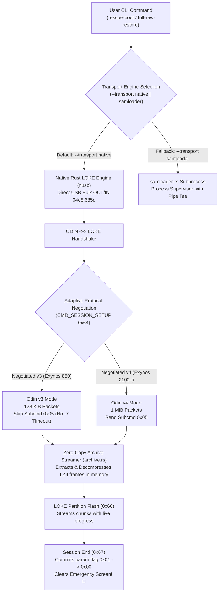

# Exynos LOKE Rescue (`exynos-loke-rescue`) 📱⚡

[](LICENSE)
[]()
[]()
[](PROTOCOL.md)
[]()
[]()
[-blueviolet.svg)]()

> **Native Linux Firmware Recovery Engine, Clean-Room Odin v3/v4 Protocol Specification, and Deterministic Partition Orchestrator for Samsung Exynos SoCs.**  
> Built from protocol reverse engineering via **REA (Reverse Engineering Anything)**, Ghidra MCP analysis, and live Linux `usbmon` wire telemetry.

---

## 📑 Table of Contents

1. [Executive Overview & Architectural Mandate](#-executive-overview--architectural-mandate)
2. [Clean-Room Reverse Engineering Methodology with REA](#-clean-room-reverse-engineering-methodology-with-rea)
   - [Legal & Architectural Clean-Room Separation](#legal--architectural-clean-room-separation)
   - [Live USB Wire Telemetry Capture (`usbmon` + `tshark`)](#live-usb-wire-telemetry-capture-usbmon--tshark)
   - [REA & Ghidra Analysis of `odin4` & `sboot.bin`](#rea--ghidra-analysis-of-odin4--sbootbin)
   - [Differential Analysis: Odin v3 vs. Odin v4](#differential-analysis-odin-v3-vs-odin-v4)
3. [Dual-Engine Architecture](#-dual-engine-architecture)
   - [Engine 1: 100% Native Rust LOKE Transport (`nusb`)](#engine-1-100-native-rust-loke-transport-nusb)
   - [Engine 2: Zero-Copy Archive Streamer & Supervisor](#engine-2-zero-copy-archive-streamer--supervisor)
4. [Repository Hierarchy](#-repository-hierarchy)
5. [Installation & Build Guide](#-installation--build-guide)
6. [CLI Command Reference](#-cli-command-reference)
7. [Operational Runbooks](#-operational-runbooks)
   - [Runbook A: Clearing "An error has occurred..."](#runbook-a-clearing-the-blue-an-error-has-occurred-screen)
   - [Runbook B: Recovering from Post-LineageOS Dynamic `super` Bootloops](#runbook-b-recovering-from-post-lineageos-dynamic-super-bootloops)
   - [Runbook C: Resolving `LOKE FAIL! [code: -1]` & VaultKeeper Locks](#runbook-c-resolving-loke-fail-code--1--vaultkeeper-prenormal-locks)
   - [Runbook D: Clean LineageOS Installation Post-Recovery](#runbook-d-clean-lineageos-installation-post-recovery)
8. [Security & Partition Safety Invariants](#-security-and-partition-safety-invariants)

---

## 📌 Executive Overview & Architectural Mandate

Modern Samsung Galaxy smartphones powered by Exynos System-on-Chips (SoCs) implement a proprietary low-level flashing interface inside their secondary bootloader (`sboot.bin`), internally named **LOKE** (the device-side counterpart to Samsung's desktop **Odin** flashing protocol).

Across GNU/Linux environments, developers and custom ROM maintainers (such as LineageOS builders) face severe reliability barriers when flashing Exynos devices:

1. **The Odin v4 `-7` Bulk Timeout:** Leaked Linux `odin4` binaries unconditionally issue Odin v4 device-type query packets (`CMD_SESSION_SETUP` subcommand `0x05`) immediately after the initial handshake. Exynos 850 (`S5E3830`) bootloaders only implement Odin v3, silently dropping the v4 query and triggering `USB bulk read failed (error: -7)` timeouts.
2. **Heimdall Session Termination Hang:** `Heimdall v2.2.2` speaks Odin v3 framing but emits an outdated `SESSION_END` control structure that modern Exynos `sboot` bootloaders reject, leaving the bootloader's persistent `param` update flag burned at `0x01` (Emergency Recovery Loop).
3. **`samloader-rs` Dynamic Partition Crash:** `samloader-rs` speaks valid LOKE framing, but its `AP` tarball handler enforces a pre-flight `super` partition geometry check that crashes whenever leftover custom ROM logical partition extents are present—even with `--skip-size-check`.

`exynos-loke-rescue` permanently solves all three issues:
* **Native Rust LOKE Transport (`nusb`):** Directly implements the clean-room Odin v3/v4 wire protocol over raw USB bulk endpoints with adaptive protocol negotiation, requiring **zero external binaries**.
* **Zero-Copy Streaming Decompression:** Streams partition payloads (`boot`, `vbmeta`, `recovery`, `dtbo`, `super`) directly out of multi-gigabyte `AP_*.tar.md5` archives and flashes them via targeted partition commands (`-p`), completely bypassing dynamic partition calculation bugs.

---

## 🔬 Clean-Room Reverse Engineering Methodology with REA

### Legal & Architectural Clean-Room Separation
To guarantee clean intellectual property boundaries and strict MIT License compatibility, all protocol specifications were produced via a two-phase clean-room process:
* **Phase I (Protocol Specification - [`PROTOCOL.md`](PROTOCOL.md)):** Developed using **REA (Reverse Engineering Anything)**, Ghidra MCP decompilation of unstripped `odin4` symbols, and passive Linux kernel `usbmon` packet telemetry. Contains abstract wire frame definitions, offsets, and state machine diagrams.
* **Phase II (Clean-Room Implementation):** Implemented in memory-safe Rust (`src/loke_proto.rs` and `src/nusb_transport.rs`) referencing only [`PROTOCOL.md`](PROTOCOL.md).

### Live USB Wire Telemetry Capture (`usbmon` + `tshark`)
Live packet captures of official Odin sessions were captured on Linux using the kernel `usbmon` facility:
```bash
# Capture USB bulk frames during active session
./scripts/capture_usbmon.sh ~/loke_capture.pcapng
```

### REA & Ghidra Analysis of `odin4` & `sboot.bin`
Using REA's Ghidra integration to analyze target artifacts:
1. **Host Reference (`odin4`):** Disassembly of `libusb_bulk_transfer` wrappers mapped control frame opcodes (`0x64`–`0x67`), revealing that `odin4` sends subcommand `0x05` unconditionally.
2. **Device Reference (`sboot.bin`):** Decompilation of the ARM64 Little Kernel (LK) command switch loop at base address `0x8F000000` revealed:
   * `case 0x64`: Rejection of unknown subcommands (`0x05` returns zero bytes).
   * `case 0x66`: Appended signature verification (`SEANDROIDENFORCE`) and the exact logic that returns `[0xFFFFFFFF, -1]` when `KG State: Prenormal` rejects unsigned custom images.
   * `case 0x67`: Commits `param` partition flag from `0x01` to `0x00`.

To prepare `sboot.bin` for REA / Ghidra analysis:
```bash
./scripts/rea_extract_sboot.sh stock_fw/BL_*.tar.md5
```

### Differential Analysis: Odin v3 vs. Odin v4

| Step | Odin v3 (Exynos 850 / Galaxy A21s) | Odin v4 (Exynos 2100+ / Modern Flagships) |
| :--- | :--- | :--- |
| **1. Handshake** | Host $\rightarrow$ `"ODIN"` (4B) | Host $\rightarrow$ `"ODIN"` (4B) |
| **2. Response** | Device $\rightarrow$ `"LOKE"` (4B) | Device $\rightarrow$ `"LOKE"` (4B) |
| **3. Session Init** | Host $\rightarrow$ `[0x64, 0x00, 0x04...]` (1024B) | Host $\rightarrow$ `[0x64, 0x00, 0x04...]` (1024B) |
| **4. Negotiation** | Device $\rightarrow$ `[0x64, 0x03...]` (Negotiated v3) | Device $\rightarrow$ `[0x64, 0x04...]` (Negotiated v4) |
| **5. Query Device** | **SKIPPED** *(Sending causes error: -7 timeout!)* | Host $\rightarrow$ `[0x64, 0x05...]` (Query Device Type) |
| **6. Max Packet** | `131,072` Bytes (128 KiB bulk transfers) | `1,048,576` Bytes (1 MiB bulk transfers) |

---

## ⚡ Dual-Engine Architecture



---

## 📂 Repository Hierarchy

```text
exynos-loke-rescue/
├── Cargo.toml                      # Package metadata & optimized release profile
├── LICENSE                         # MIT License
├── PROTOCOL.md                     # Clean-room wire protocol specification
├── README.md                       # Comprehensive guide & operational runbooks
├── .gitignore                      # Ignore build targets, archives, and images
├── udev/
│   └── 60-exynos-loke-rescue.rules # Kernel udev rules with ID_MM_DEVICE_IGNORE
├── scripts/
│   ├── install.sh                  # Automated toolchain installer
│   ├── capture_usbmon.sh           # Live Odin wire telemetry capture
│   ├── rea_extract_sboot.sh        # Unpacks sboot.bin for REA / Ghidra analysis
│   ├── 01_setup_usb.sh             # Standalone bash USB sanitizer
│   ├── 02_extract_img.sh           # Standalone bash lz4 extractor
│   ├── 03_flash_signed.sh          # Standalone bash boot component flasher
│   └── 04_flash_stock_os.sh        # Standalone bash raw SUPER & DTBO flasher
├── src/
│   ├── main.rs                     # Primary CLI coordinator & state machine
│   ├── cli.rs                      # Clap v4 argument parser & subcommands
│   ├── error.rs                    # Structured error taxonomy (RescueError)
│   ├── usb.rs                      # Direct /sys/bus/usb/devices scanner & sanitizer
│   ├── loke_proto.rs               # Clean-room Odin v3/v4 wire framing & structs
│   ├── nusb_transport.rs           # Direct native USB bulk I/O engine via nusb
│   ├── pit.rs                      # Samsung binary PIT table parser (132-byte layout)
│   ├── archive.rs                  # Zero-copy .tar.md5 and .lz4 frame streamer
│   ├── diagnostics.rs              # Real-time LOKE error pattern interpreter
│   └── flasher.rs                  # Dual-backend native + samloader execution supervisor
└── tests/
    └── protocol_and_archive_tests.rs # Test suite for control frames, PIT, and tar.md5
```

---

## 🛠️ Installation & Build Guide

### Automated Quick Install (Fedora, Debian, Ubuntu, Arch)
```bash
git clone https://github.com/rebeeh/exynos-loke-rescue.git
cd exynos-loke-rescue
./scripts/install.sh
```

### Manual Build
```bash
# 1. Install system prerequisites
sudo dnf install -y rust cargo curl unzip usbutils lz4   # Fedora
# sudo apt install -y cargo rustc curl unzip usbutils liblz4-tool  # Ubuntu/Debian

# 2. Build release binary
cargo build --release
sudo cp target/release/exynos-loke-rescue /usr/local/bin/

# 3. Install udev rules
sudo cp udev/60-exynos-loke-rescue.rules /etc/udev/rules.d/
sudo udevadm control --reload-rules && sudo udevadm trigger
```

---

## 💻 CLI Command Reference

### 1. Sanitize USB Stack
```bash
exynos-loke-rescue prep-usb
```
* Pauses `ModemManager` and configures `ID_MM_DEVICE_IGNORE="1"`.
* Unloads conflicting `cdc_acm` kernel driver.
* Verifies presence of Samsung Download Mode (`04e8:685d`).

### 2. Probe Device & Negotiate Protocol (Native Engine)
```bash
exynos-loke-rescue probe
```
* Performs native `ODIN` $\leftrightarrow$ `LOKE` handshake.
* Negotiates protocol tier (`OdinV3` vs `OdinV4`).
* Dumps and prints the live device Partition Information Table (PIT).

### 3. Fetch Official Stock Firmware
```bash
exynos-loke-rescue fetch-stock -m SM-A217F -r INS --out-dir ~/Downloads/stock
```

### 4. Mode 1: Clear Emergency Recovery Screen (Unbrick)
```bash
exynos-loke-rescue rescue-boot --ap ~/Downloads/stock
```
* Streams `boot.img`, `vbmeta.img`, and `recovery.img` directly from `AP_*.tar.md5`.
* Flashes signed components to satisfy Knox integrity checks.
* Sends `CMD_SESSION_END (0x67)` to commit `param` flag `0x01` $\rightarrow$ `0x00`.

### 5. Mode 2: Full Raw Stock Restore (Bypasses Super Metadata Bugs)
```bash
exynos-loke-rescue full-raw-restore --stock-dir ~/Downloads/stock
```
* Flashes `BOOT`, `VBMETA`, `RECOVERY`, `DTBO`, and `SUPER` partition-by-partition.
* Completely bypasses `samloader-rs`'s dynamic partition pre-flight crash.

---

## 📖 Operational Runbooks

### Runbook A: Clearing the Blue "An error has occurred..." Screen
1. Connect device via USB-A 2.0 cable to host.
2. Run `exynos-loke-rescue prep-usb`.
3. Run `exynos-loke-rescue probe` to verify communication.
4. Execute `exynos-loke-rescue rescue-boot --ap ~/Downloads/stock`.
5. Device verifies signatures, resets `param` flag to `0x00`, and exits the emergency loop.

### Runbook B: Recovering from Post-LineageOS Dynamic `super` Bootloops
1. If the device clears the emergency screen but bootloops on the Samsung logo:
   * Hold **Volume Down + Power** for 8 seconds until the screen goes black.
   * Immediately hold **Volume Up + Volume Down** with USB connected to enter Download Mode.
2. Run `exynos-loke-rescue full-raw-restore --stock-dir ~/Downloads/stock`.
3. In Samsung Stock Recovery, select **Wipe data / factory reset**.
4. Select **Reboot system now** and allow 5–8 minutes for One UI first boot.

### Runbook C: Resolving `LOKE FAIL! [code: -1]` & VaultKeeper Prenormal Locks
1. If custom recovery flashing is rejected with `[code: -1]`, VaultKeeper has locked `KG State` to `Prenormal`.
2. Boot into stock One UI (Runbook B).
3. Connect to Wi-Fi and wait 60 seconds for Knox Guard background sync.
4. Go to **Settings $\rightarrow$ Developer options** and confirm **OEM unlocking** is ON and greyed out.
5. Reboot to Download Mode (`adb reboot download`).

### Runbook D: Clean LineageOS Installation Post-Recovery
1. Flash Lineage Recovery and `vbmeta` with `--no-reboot`:
   ```bash
   exynos-loke-rescue flash-custom-recovery \
       --recovery ~/Downloads/recovery.img \
       --vbmeta ~/Downloads/vbmeta.img
   ```
2. Unplug USB, hold **Volume Down + Power** until black, then immediately hold **Volume Up + Power** to enter Lineage Recovery.
3. Select **Factory reset $\rightarrow$ Format data/factory reset**.
4. Select **Apply update $\rightarrow$ Apply from ADB**, and sideload:
   ```bash
   adb sideload ~/Downloads/lineage-*.zip
   ```

---

## 🔒 Security and Partition Safety Invariants

* **IMEI & Baseband Invariance:** Partitions `EFS`, `SEC_EFS`, `CPEFS`, and `NVDATA` are strictly protected from modification.
* **PIT Boundary Validation:** `nusb_transport.rs` cross-references every image against `PITEntry.size_bytes()` before transmitting over USB.
* **eFuse Anti-Rollback Protection:** `fetch-stock` pulls active firmware $\ge$ the hardware fuse revision to prevent `SW REV. CHECK FAIL`.

---

## 📄 License

This project is licensed under the [MIT License](LICENSE).  
Clean-room protocol specification derived via REA and Linux `usbmon` telemetry.  
Copyright (c) 2026 Rabeeh Fouz Ahammad VK.
