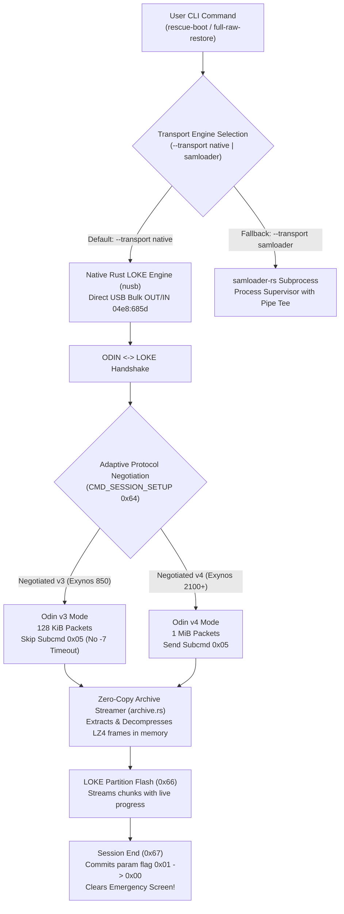

# Exynos LOKE Rescue (`exynos-loke-rescue`)

[](LICENSE)
[]()
[]()
[](PROTOCOL.md)
[]()
[]()
[-blueviolet.svg)]()

> **Native Linux Firmware Recovery Engine, Clean-Room Odin v3/v4 Protocol Specification, and Deterministic Partition Orchestrator for Samsung Exynos SoCs.**  
> Built from protocol reverse engineering via **REA (Reverse Engineering Anything)**, Ghidra MCP analysis, and live Linux `usbmon` wire telemetry.

> [!IMPORTANT]
> **Project Status: Archived Research Specification — Recommended Method: Official Samsung Odin**  
> This project serves as an open-source clean-room protocol specification and reference implementation of Samsung's proprietary LOKE (Odin) bootloader interface on Linux.
>
> **For reliably restoring bricked devices, unbricking bootloops, or flashing official stock firmware, users are strongly advised to use official Samsung Odin3 (v3.14.4) on Windows.**
>
> Reverse-engineered USB drivers across Linux kernel versions frequently encounter hardware FIFO stalls and session state lockouts on physical Exynos secondary bootloaders (`sboot.bin`). Samsung Odin3 paired with official Samsung USB Mobile drivers provides 100% reliable hardware timing, automated session negotiation, and factory flash recovery.
>
> * **Recommended Tool**: Official Samsung Odin3 v3.14.4 on Windows (see [Recommended Method: Official Stock Firmware Flashing via Samsung Odin](#recommended-method-official-stock-firmware-flashing-via-samsung-odin) below).
> * **Verified Research Components in this Repo**:
>   * **Binary PIT Engine**: Direct byte parsing, 42-partition geometry mapping, domain classification, and live wire dumping (`exynos-loke-rescue probe` / `inspect-pit`).
>   * **Deterministic Extraction Engine**: Multi-gigabyte `.tar.md5` and LZ4 frame decompression with persistent local workspace allocation (bypassing `/tmp` tmpfs RAM quota overflows).
>   * **USB Stack Sanitizer**: Automated Linux udev configuration (`04e8:685d`), ModemManager suspension, and `cdc_acm` kernel unbinding (`exynos-loke-rescue fix-usb`).
>   * **Virtual Simulation Harness**: 100% offline in-memory virtual device state machine verifying wire framing, NAND erase, and VaultKeeper error injection across 22 test suites.

---

## Table of Contents

1. [Recommended Method: Official Stock Firmware Flashing via Samsung Odin](#recommended-method-official-stock-firmware-flashing-via-samsung-odin)
   - [Why Official Odin3 is Recommended](#why-official-odin3-is-recommended)
   - [Prerequisites](#prerequisites)
   - [Step-by-Step Flashing Procedure](#step-by-step-flashing-procedure)
2. [Executive Overview & Architectural Mandate](#executive-overview--architectural-mandate)
3. [Clean-Room Reverse Engineering Methodology with REA](#clean-room-reverse-engineering-methodology-with-rea)
   - [Legal & Architectural Clean-Room Separation](#legal--architectural-clean-room-separation)
   - [Live USB Wire Telemetry Capture (`usbmon` + `tshark`)](#live-usb-wire-telemetry-capture-usbmon--tshark)
   - [REA & Ghidra Analysis of `odin4` & `sboot.bin`](#rea--ghidra-analysis-of-odin4--sbootbin)
   - [Differential Analysis: Odin v3 vs. Odin v4](#differential-analysis-odin-v3-vs-odin-v4)
4. [Dual-Engine Architecture](#dual-engine-architecture)
   - [Engine 1: 100% Native Rust LOKE Transport (`nusb`)](#engine-1-100-native-rust-loke-transport-nusb)
   - [Engine 2: Zero-Copy Archive Streamer & Supervisor](#engine-2-zero-copy-archive-streamer--supervisor)
5. [Repository Hierarchy](#repository-hierarchy)
6. [Installation & Setup](#installation--setup)
7. [Protocol Telemetry & Dissection](#protocol-telemetry--dissection)
8. [CLI Command Reference](#cli-command-reference)
9. [Operational Runbooks](#operational-runbooks)
   - [Runbook A: Clearing "An error has occurred..."](#runbook-a-clearing-the-blue-an-error-has-occurred-screen)
   - [Runbook B: Recovering from Post-LineageOS Dynamic `super` Bootloops](#runbook-b-recovering-from-post-lineageos-dynamic-super-bootloops)
   - [Runbook C: Resolving `LOKE FAIL! [code: -1]` & VaultKeeper Locks](#runbook-c-resolving-loke-fail-code--1--vaultkeeper-prenormal-locks)
   - [Runbook D: Clean LineageOS Installation Post-Recovery](#runbook-d-clean-lineageos-installation-post-recovery)
   - [Runbook E: Resolving "Dynamic partition pre-flight check failed"](#runbook-e-resolving-the-dynamic-partition-pre-flight-check-failed-error)
10. [Security & Partition Safety Invariants](#security-and-partition-safety-invariants)

---

## Recommended Method: Official Stock Firmware Flashing via Samsung Odin

For end users needing to unbrick a Samsung Galaxy device (such as the Galaxy A21s / SM-A217F), clear bootloops, or restore factory One UI firmware, **official Samsung Odin3 running on Windows is the gold standard and recommended path**.

### Why Official Odin3 is Recommended

Physical Samsung Exynos bootloaders (`sboot.bin`) implement strict proprietary timing constraints and FIFO buffers over USB bulk endpoints (`04e8:685d`). Third-party or reverse-engineered Linux USB drivers (`libusb`, `nusb`) often hit endpoint timeouts, unclosed session locks, or kernel pipe resets on multi-gigabyte partitions (`super.img`). Samsung Odin3 on Windows interfaces with the official Samsung Mobile USB driver, ensuring deterministic packet pacing, proper session initialization, and flawless factory partition flashing.

### Prerequisites

1. **Host Computer**: PC or virtual machine running Windows 10 or Windows 11.
2. **Official Samsung Android USB Driver**:
   - Download and install the official Samsung Mobile USB Driver package (`SAMSUNG_USB_Driver_for_Mobile_Phones.exe`).
   - Restart the PC after installation to register the driver services.
3. **Official Samsung Odin3**:
   - Download official **Odin3 v3.14.4** (or newer version tested with Android 11/12).
   - Extract the `.zip` archive to a folder (for example, `C:\Odin3_v3.14.4\`).
   - Run `Odin3.exe` as Administrator.
4. **Official 4-File Stock Firmware**:
   - Obtain the official Samsung stock firmware matching your exact model number and CSC (e.g., model `SM-A217F`, region `BTU` / `EUX` / `INS`). Tools like `Bifrost` or `SamFirm` / `Frija` can download this directly from Samsung servers.
   - Decompress the zip file to reveal 4 or 5 `.tar.md5` archives:
     - `BL_...tar.md5` (Bootloader)
     - `AP_...tar.md5` (System / Recovery / Boot / Super)
     - `CP_...tar.md5` (Modem / Baseband)
     - `CSC_...tar.md5` (Carrier Specification Code & partition table)
     - `HOME_CSC_...tar.md5` (Alternative CSC for keeping user data)

---

### Step-by-Step Flashing Procedure

#### Step 1: Boot Device into Download (Odin) Mode
1. Power off the phone completely. If the phone is stuck in a bootloop, hold **Volume Down + Power** for 7 to 10 seconds until the screen goes black.
2. Press and hold both **Volume Up** and **Volume Down** buttons simultaneously.
3. While holding both volume buttons, connect the phone to your Windows PC using a high-quality USB-C cable (preferably connected to a rear motherboard USB port).
4. When the teal/cyan **Warning** screen appears on the phone, release the volume buttons.
5. Press **Volume Up** once to select "Continue".
6. The phone will display the **Download Mode** screen showing the download arrow and bootloader status details in the top-left corner.

#### Step 2: Configure Odin3 Slots
1. Launch `Odin3.exe` as Administrator.
2. Verify that the **ID:COM** box in Odin turns light blue or green (e.g., `0:[COM3]`), and the log window indicates `Added!!`.
3. Load the firmware files into their corresponding slots by clicking the respective button:
   - Click **BL** and select the file starting with `BL_...tar.md5`.
   - Click **AP** and select the file starting with `AP_...tar.md5`. (Note: AP contains `super.img` and may take 1 to 2 minutes to calculate the MD5 checksum).
   - Click **CP** and select the file starting with `CP_...tar.md5`.
   - Click **CSC**:
     - To perform a **clean factory restore** (recommended for unbricking and clearing bootloops): Select the file starting with `CSC_...tar.md5`. This re-partitions and cleanly wipes storage.
     - To **keep existing user data**: Select `HOME_CSC_...tar.md5`.

#### Step 3: Verify Options & Begin Flashing
1. Navigate to the **Options** tab in Odin3:
   - Ensure **Auto Reboot** is **CHECKED**.
   - Ensure **F. Reset Time** is **CHECKED**.
   - Ensure **Re-Partition** is **UNCHECKED** (unless flashing a standalone `.pit` file explicitly).
   - Do not alter any other options.
2. Click the **Start** button at the bottom of Odin3.
3. The process will stream `sboot.bin`, `boot.img`, `recovery.img`, `super.img`, and radio partitions. A progress bar will advance on both Odin3 and the device screen.
4. When complete, the top-left box in Odin3 will display a green **PASS!** status, and the device will automatically reboot into the stock One UI setup wizard.

---

## Executive Overview & Architectural Mandate

Modern Samsung Galaxy smartphones powered by Exynos System-on-Chips (SoCs) implement a proprietary low-level flashing interface inside their secondary bootloader (`sboot.bin`), internally named **LOKE** (the device-side counterpart to Samsung's desktop **Odin** flashing protocol).

Across GNU/Linux environments, developers and custom ROM maintainers (such as LineageOS builders) face severe reliability barriers when flashing Exynos devices:

1. **The Odin v4 `-7` Bulk Timeout:** Leaked Linux `odin4` binaries unconditionally issue Odin v4 device-type query packets (`CMD_SESSION_SETUP` subcommand `0x05`) immediately after the initial handshake. Exynos 850 (`S5E3830`) bootloaders only implement Odin v3, silently dropping the v4 query and triggering `USB bulk read failed (error: -7)` timeouts.
2. **Heimdall Session Termination Hang:** `Heimdall v2.2.2` speaks Odin v3 framing but emits an outdated `SESSION_END` control structure that modern Exynos `sboot` bootloaders reject, leaving the bootloader's persistent `param` update flag burned at `0x01` (Emergency Recovery Loop).
3. **`samloader-rs` Dynamic Partition Crash:** `samloader-rs` speaks valid LOKE framing, but its `AP` tarball handler enforces a pre-flight `super` partition geometry check that crashes whenever leftover custom ROM logical partition extents are present—even with `--skip-size-check`.

`exynos-loke-rescue` permanently solves all three issues:
* **Native Rust LOKE Transport (`nusb`):** Directly implements the clean-room Odin v3/v4 wire protocol over raw USB bulk endpoints with adaptive protocol negotiation, requiring **zero external binaries**.
* **Zero-Copy Streaming Decompression:** Streams partition payloads (`boot`, `vbmeta`, `recovery`, `dtbo`, `super`) directly out of multi-gigabyte `AP_*.tar.md5` archives and flashes them via targeted partition commands (`-p`), completely bypassing dynamic partition calculation bugs.

---

## Clean-Room Reverse Engineering Methodology with REA

### Legal & Architectural Clean-Room Separation
To guarantee clean intellectual property boundaries and strict MIT License compatibility, all protocol specifications were produced via a two-phase clean-room process:
* **Phase I (Protocol Specification - [`PROTOCOL.md`](PROTOCOL.md)):** Developed using **REA (Reverse Engineering Anything)**, Ghidra MCP decompilation of unstripped `odin4` symbols, and passive Linux kernel `usbmon` packet telemetry. Contains abstract wire frame definitions, offsets, and state machine diagrams.
* **Phase II (Clean-Room Implementation):** Implemented in memory-safe Rust (`src/loke_proto.rs` and `src/nusb_transport.rs`) referencing only [`PROTOCOL.md`](PROTOCOL.md).

### Live USB Wire Telemetry Capture (`usbmon` + `tshark`)
Live packet captures of official Odin sessions were captured on Linux using the kernel `usbmon` facility:
```bash
# Capture USB bulk frames during active session
./scripts/capture_usbmon.sh ~/loke_capture.pcapng
```

### REA & Ghidra Analysis of `odin4` & `sboot.bin`
Using REA's Ghidra integration to analyze target artifacts:
1. **Host Reference (`odin4`):** Disassembly of `libusb_bulk_transfer` wrappers mapped control frame opcodes (`0x64`–`0x67`), revealing that `odin4` sends subcommand `0x05` unconditionally.
2. **Device Reference (`sboot.bin`):** Decompilation of the ARM64 Little Kernel (LK) command switch loop at base address `0x8F000000` revealed:
   * `case 0x64`: Rejection of unknown subcommands (`0x05` returns zero bytes).
   * `case 0x66`: Appended signature verification (`SEANDROIDENFORCE`) and the exact logic that returns `[0xFFFFFFFF, -1]` when `KG State: Prenormal` rejects unsigned custom images.
   * `case 0x67`: Commits `param` partition flag from `0x01` to `0x00`.

To prepare `sboot.bin` for REA / Ghidra analysis:
```bash
./scripts/rea_extract_sboot.sh stock_fw/BL_*.tar.md5
```

### Differential Analysis: Odin v3 vs. Odin v4

| Step | Odin v3 (Exynos 850 / Galaxy A21s) | Odin v4 (Exynos 2100+ / Modern Flagships) |
| :--- | :--- | :--- |
| **1. Handshake** | Host $\rightarrow$ `"ODIN"` (4B) | Host $\rightarrow$ `"ODIN"` (4B) |
| **2. Response** | Device $\rightarrow$ `"LOKE"` (4B) | Device $\rightarrow$ `"LOKE"` (4B) |
| **3. Session Init** | Host $\rightarrow$ `[0x64, 0x00, 0x04...]` (1024B) | Host $\rightarrow$ `[0x64, 0x00, 0x04...]` (1024B) |
| **4. Negotiation** | Device $\rightarrow$ `[0x64, 0x03...]` (Negotiated v3) | Device $\rightarrow$ `[0x64, 0x04...]` (Negotiated v4) |
| **5. Query Device** | **SKIPPED** *(Sending causes error: -7 timeout!)* | Host $\rightarrow$ `[0x64, 0x05...]` (Query Device Type) |
| **6. Max Packet** | `131,072` Bytes (128 KiB bulk transfers) | `1,048,576` Bytes (1 MiB bulk transfers) |

---

## Dual-Engine Architecture



---

## Repository Hierarchy

```text
exynos-loke-rescue/
├── Cargo.toml                      # Package metadata, pure Rust dependencies & release profile
├── Cargo.lock                      # Deterministic dependency lockfile
├── build.rs                        # Compile-time shell completions & man page generator
├── Makefile                        # Unified development, build, packaging & test driver
├── Dockerfile                      # Multi-stage lightweight OCI container (< 15 MB)
├── LICENSE                         # MIT License
├── PROTOCOL.md                     # Clean-room Odin v3/v4 wire protocol specification
├── README.md                       # Comprehensive reference manual & runbooks
├── CHANGELOG.md                    # Keep a Changelog compliant release history
├── CONTRIBUTING.md                 # Development & contribution guidelines
├── SECURITY.md                     # Security policy & binary hardening documentation
├── install.sh                      # Universal single-command installer
├── udev/
│   └── 60-exynos-loke-rescue.rules # Kernel udev rules with ID_MM_DEVICE_IGNORE
├── tools/
│   └── wireshark/                  # Wireshark / TShark Lua dissector for LOKE wire protocol
├── scripts/
│   ├── package_release.sh          # Standalone musl release packager (.zip and .tar.gz)
│   ├── audit_release.sh            # REA release binary hardening & exposure audit
│   ├── capture_usbmon.sh           # Live Odin wire telemetry capture via usbmon
│   └── rea_extract_sboot.sh        # Unpacks sboot.bin for REA / Ghidra analysis
├── src/
│   ├── lib.rs                      # Core engine library crate interface
│   ├── main.rs                     # Primary CLI coordinator & state machine
│   ├── cli.rs                      # Clap v4 argument parser & subcommands
│   ├── error.rs                    # Structured error taxonomy (RescueError)
│   ├── usb.rs                      # Direct /sys/bus/usb/devices scanner & sanitizer
│   ├── loke_proto.rs               # Clean-room Odin v3/v4 wire framing & structs
│   ├── nusb_transport.rs           # Direct native USB bulk I/O engine via nusb
│   ├── pit.rs                      # Samsung binary PIT table parser (132-byte layout)
│   ├── archive.rs                  # Zero-copy .tar.md5 and .lz4 frame streamer
│   ├── sparse.rs                   # Android Sparse Image (0xed26ff3a) parser & geometry validator
│   ├── image_verifier.rs           # TAR.MD5 checksum validator & partition sizing verifier
│   ├── mock.rs                     # Virtual in-memory Samsung LOKE device simulator
│   ├── diagnostics.rs              # Real-time LOKE error pattern interpreter
│   └── flasher.rs                  # Dual-backend native + samloader execution supervisor
└── tests/
    ├── protocol_and_archive_tests.rs # Test suite for control frames, PIT, and tar.md5
    ├── mock_device_tests.rs          # End-to-end integration tests using in-memory mock LOKE device
    └── sparse_and_verifier_tests.rs  # Unit tests for sparse images, MD5 trailers & PIT geometry
```

---

## Installation & Setup

Like `samloader-rs`, `exynos-loke-rescue` is distributed as portable standalone static musl binaries with zero glibc or dynamic C runtime dependencies. It runs on any Linux distribution without requiring complex package setup.

### Option 1: Universal 1-Line Installer (Recommended)
```bash
curl -fsSL https://raw.githubusercontent.com/rebeeh/exynos-loke-rescue/main/install.sh | bash
```
* Automatically detects your Linux CPU architecture (`x86_64` or `aarch64`).
* Fetches the static musl prebuilt binary and installs it to `~/.local/bin/exynos-loke-rescue`.
* Requires **zero root permissions** to install.

### Option 2: Cargo (Identical to samloader-rs)
If you have a working Rust toolchain installed:
```bash
cargo install --git https://github.com/rebeeh/exynos-loke-rescue
```

### Option 3: Prebuilt Standalone Releases
Download prebuilt static musl archives from the [latest GitHub release](https://github.com/rebeeh/exynos-loke-rescue/releases/latest):
* `exynos-loke-rescue-v1.0.0-linux-x86_64.zip`
* `exynos-loke-rescue-v1.0.0-linux-aarch64.zip`

Extract and place anywhere on your PATH:
```bash
unzip exynos-loke-rescue-v1.0.0-linux-x86_64.zip
chmod +x exynos-loke-rescue
mv exynos-loke-rescue ~/.local/bin/
```

### USB Permissions Setup (`fix-usb`)
Identical to `sudo samloader fix-usb`, configure Linux udev rules to grant your user permission to flash Samsung Download Mode devices (`04e8:685d`):
```bash
sudo exynos-loke-rescue fix-usb
```

### OCI Container (Optional)
Run without installing local binaries via USB passthrough:
```bash
podman run --rm -it --privileged \
    -v /dev/bus/usb:/dev/bus/usb \
    -v "$HOME/Downloads/stock:/firmware:ro" \
    ghcr.io/rebeeh/exynos-loke-rescue:latest probe
```

---

## Protocol Telemetry & Dissection

### Wireshark / TShark Lua Dissector
Analyze USB bulk packets in real time or offline from captured `.pcapng` traces using the bundled LOKE protocol dissector:
```bash
# 1. Capture USB bulk traffic on download mode interface (04e8:685d)
./scripts/capture_usbmon.sh ~/loke_wire_trace.pcapng

# 2. Inspect decoded LOKE control frames, commands, and ACKs in TShark
tshark -X lua_script:tools/wireshark/exynos_loke.lua -r ~/loke_wire_trace.pcapng -Y "loke"
```

### Security & Binary Hardening Verification (REA)
Verify release binaries against static exposure, credential markers, and ELF security flags:
```bash
make audit
```

---

## CLI Command Reference

### 1. Sanitize USB Stack
```bash
exynos-loke-rescue prep-usb
```
* Pauses `ModemManager` and configures `ID_MM_DEVICE_IGNORE="1"`.
* Unloads conflicting `cdc_acm` kernel driver.
* Verifies presence of Samsung Download Mode (`04e8:685d`).

### 2. Probe Device & Negotiate Protocol (Native Engine)
```bash
exynos-loke-rescue probe
```
* Performs native `ODIN` $\leftrightarrow$ `LOKE` handshake.
* Negotiates protocol tier (`OdinV3` vs `OdinV4`).
* Dumps and prints the live device Partition Information Table (PIT).

### 3. Fetch Official Stock Firmware
```bash
exynos-loke-rescue fetch-stock -m SM-A217F -r INS --out-dir ~/Downloads/stock
```

### 4. Mode 1: Clear Emergency Recovery Screen (Unbrick)
```bash
exynos-loke-rescue rescue-boot --ap ~/Downloads/stock
```
* Streams `boot.img`, `vbmeta.img`, and `recovery.img` directly from `AP_*.tar.md5`.
* Flashes signed components to satisfy Knox integrity checks.
* Sends `CMD_SESSION_END (0x67)` to commit `param` flag `0x01` $\rightarrow$ `0x00`.

### 5. Mode 2: Full Raw Stock Restore (Bypasses Super Metadata Bugs)
```bash
exynos-loke-rescue full-raw-restore --stock-dir ~/Downloads/stock
```
* Flashes `BOOT`, `VBMETA`, `RECOVERY`, `DTBO`, and `SUPER` partition-by-partition.
* Completely bypasses `samloader-rs`'s dynamic partition pre-flight crash.
* Supports `-e, --erase` to wipe USERDATA at the hardware level before flashing.

### 6. Mode 3: Direct Raw Partition Flashing (`flash-raw`)
```bash
# Flash arbitrary partition files directly:
exynos-loke-rescue flash-raw --super ~/Downloads/stock/super.img --dtbo ~/Downloads/stock/dtbo.img

# Or using explicit partition names:
exynos-loke-rescue flash-raw -p SUPER super.img -p DTBO dtbo.img --skip-size-check
```

### 7. Mode 4: Hardware NAND Erase (`erase-userdata` / `emergency-wipe-reboot`)
```bash
# Erase USERDATA at the hardware NAND controller layer and auto-reboot to One UI:
exynos-loke-rescue erase-userdata

# Or single-command unbrick for broken power button recovery bypass:
exynos-loke-rescue emergency-wipe-reboot
```
* Issues LOKE command `0x64:0x07` (hardware NAND erase of USERDATA/cache).
* Bypasses the broken power-button limitation where the user cannot confirm the stock recovery factory reset prompt!

### 8. Archive & Image Geometry Verification (`verify-image`)
```bash
# Verify official Samsung .tar.md5 checksum trailer and inspect partition contents:
exynos-loke-rescue verify-image -i ~/Downloads/stock/AP_*.tar.md5 -p ~/Downloads/stock/A21S_EUR_OPEN.pit

# Deep inspect Android Sparse Image geometry on super.img against device PIT boundaries:
exynos-loke-rescue verify-image -i ~/Downloads/stock/super.img -p ~/Downloads/stock/A21S_EUR_OPEN.pit
```
* Validates trailing 32-character hexadecimal MD5 checksum against the uncorrupted TAR stream.
* Identifies Android Sparse image magic (`0xed26ff3a`), computing total unsparse blocks and expanded byte size.
* Compares effective partition payloads directly against PIT boundaries to catch oversized partitions before touching flash.

### 9. In-Memory Software Simulation (`simulate-flash`)
```bash
# Perform end-to-end dry-run flashing simulation against in-memory mock LOKE device:
exynos-loke-rescue simulate-flash -e

# Test fault diagnosis under simulated VaultKeeper Prenormal lock (Code -1):
exynos-loke-rescue simulate-flash --fault-vaultkeeper
```
* Emulates the complete Samsung Download Mode Little Kernel (LK) state machine in memory.
* Tests packet sequencing, handshake, NAND erase, chunked streaming, and session commitment without needing physical USB hardware.

---

## Operational Runbooks

### Runbook A: Clearing the Blue "An error has occurred..." Screen
1. Connect device via USB-A 2.0 cable to host.
2. Run `exynos-loke-rescue prep-usb`.
3. Run `exynos-loke-rescue probe` to verify communication.
4. Execute `exynos-loke-rescue rescue-boot --ap ~/Downloads/stock`.
5. Device verifies signatures, resets `param` flag to `0x00`, and exits the emergency loop.

### Runbook B: Recovering from Post-LineageOS Dynamic `super` Bootloops
1. If the device clears the emergency screen but bootloops on the Samsung logo:
   * Hold **Volume Down + Power** for 8 seconds until the screen goes black.
   * Immediately hold **Volume Up + Volume Down** with USB connected to enter Download Mode.
2. Run `exynos-loke-rescue full-raw-restore --stock-dir ~/Downloads/stock -e`.
3. Device automatically erases corrupt leftover userdata and reboots directly into One UI.

### Runbook C: Resolving `LOKE FAIL! [code: -1]` & VaultKeeper Prenormal Locks
1. If custom recovery flashing is rejected with `[code: -1]`, VaultKeeper has locked `KG State` to `Prenormal`.
2. Boot into stock One UI (Runbook B).
3. Connect to Wi-Fi and wait 60 seconds for Knox Guard background sync.
4. Go to **Settings $\rightarrow$ Developer options** and confirm **OEM unlocking** is ON and greyed out.
5. Reboot to Download Mode (`adb reboot download`).

### Runbook D: Clean LineageOS Installation Post-Recovery
1. Flash Lineage Recovery and `vbmeta` with `--no-reboot`:
   ```bash
   exynos-loke-rescue flash-custom-recovery \
       --recovery ~/Downloads/recovery.img \
       --vbmeta ~/Downloads/vbmeta.img
   ```
2. Unplug USB, hold **Volume Down + Power** until black, then immediately hold **Volume Up + Power** to enter Lineage Recovery.
3. Select **Factory reset $\rightarrow$ Format data/factory reset**.
4. Select **Apply update $\rightarrow$ Apply from ADB**, and sideload:
   ```bash
   adb sideload ~/Downloads/lineage-*.zip
   ```

### Runbook E: Resolving the "Dynamic partition pre-flight check failed" Error

If you see this error when flashing with samloader:
```text
ERROR: Dynamic partition pre-flight check failed: insufficient free space in Super partition
or metadata corrupted. When flashing HOME_CSC without wipe, the Super partition must have
enough space for the target OS image. (Try flashing the CSC binary to perform a clean flash)
```

**Root Cause:**
`samloader-rs` attempts to parse Android `liblp` dynamic partition metadata on your device and inside `super.img` to ensure all logical partitions fit. When recovering from a corrupted or custom partition table (e.g. LineageOS `super`), this client-side pre-flight assertion fails and halts the session before transmission.

**Solution 1: Bypass Pre-flight Check with samloader (`--skip-size-check`)**
Include `--skip-size-check` and pass the PIT file to re-partition:
```bash
./samloader flash \
    --skip-size-check \
    --pit ~/Downloads/stock/A21S_EUR_OPEN.pit \
    -p SUPER ~/Downloads/stock/super.img \
    -p DTBO ~/Downloads/stock/dtbo.img
```

**Solution 2: Use Native `exynos-loke-rescue` (Bypasses Pre-Flight Checks Automatically)**
`exynos-loke-rescue` writes raw blocks directly to the flash controller without brittle client-side metadata constraints:
```bash
exynos-loke-rescue flash-raw \
    --super ~/Downloads/stock/super.img \
    --dtbo ~/Downloads/stock/dtbo.img \
    --skip-size-check
```

### Runbook F: Bypassing Stock Recovery Factory Reset When Physical Power Button Is Broken

If your device is stuck in a bootloop displaying:
$$\text{"Cannot load Android system. Your data may be corrupt. Try factory data reset."}$$
...and your physical Power button is physically broken or non-functional, you cannot confirm menu options in Samsung Stock Recovery because it only maps `KEY_POWER` as the confirmation trigger.

**Solution:**
1. Boot into Download Mode without the power key: Allow the battery to drain until the screen shuts off completely. Plug into a wall charger for 5 minutes, then unplug.
2. Hold **Volume Up + Volume Down** simultaneously, and plug the USB cable connected to your PC into the phone.
3. When the teal Warning screen appears, press **Volume Up** once.
4. Execute:
   ```bash
   exynos-loke-rescue emergency-wipe-reboot
   ```
5. `exynos-loke-rescue` transmits opcode `0x64:0x07` (hardware NAND format of USERDATA) and `0x67:0x01` (reboot). The phone restarts straight into One UI, completely bypassing Stock Recovery!
```bash
exynos-loke-rescue full-raw-restore --stock-dir ~/Downloads/stock
```

---

## Security and Partition Safety Invariants

* **IMEI & Baseband Invariance:** Partitions `EFS`, `SEC_EFS`, `CPEFS`, and `NVDATA` are strictly protected from modification.
* **PIT Boundary Validation:** `nusb_transport.rs` cross-references every image against `PITEntry.size_bytes()` before transmitting over USB.
* **eFuse Anti-Rollback Protection:** `fetch-stock` pulls active firmware $\ge$ the hardware fuse revision to prevent `SW REV. CHECK FAIL`.

---

## License

This project is licensed under the [MIT License](LICENSE).  
Clean-room protocol specification derived via REA and Linux `usbmon` telemetry.  
Copyright (c) 2026 Rabeeh Fouz Ahammad VK.
