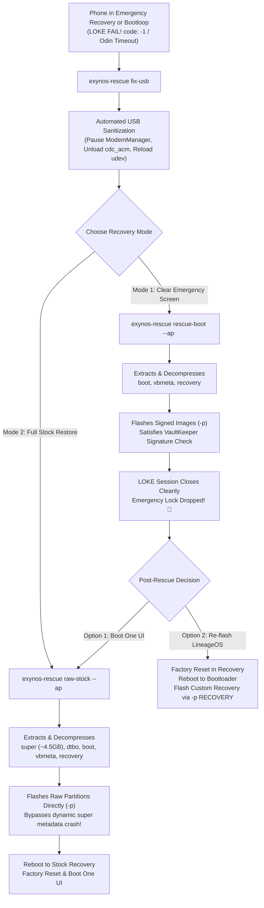

# ExynosRescue (odin-unbrick-cli) 📱⚡

[](LICENSE)
[]()
[]()
[]()
[]()
[-blueviolet.svg)]()

> **A zero-friction Linux CLI recovery orchestrator that wraps `samloader-rs`, `lz4`, and `tar` to automatically detect, extract, and flash raw signed partitions—bypassing dynamic `super` metadata crashes, Heimdall timeouts, and LOKE USB session hangs on Samsung Exynos devices.**

---

## 📌 The Problem: The Flashing Nightmare

Flashing modern Samsung Exynos devices (e.g. Galaxy A21s `SM-A217F` / Exynos 850) on Linux often turns into an unbricking deadlock where every existing open-source tool breaks on a different edge case:

* **Heimdall:** Speaks Odin v3 protocol but fails to transmit session-end confirmation packets on newer Exynos chips, resulting in frozen LOKE sessions.
* **Llucs / odin4:** Triggers bulk read timeouts (`error: -7`) on USB endpoints because older and mid-range Exynos bootloaders reject Odin v4 protocol packets.
* **`samloader-rs`:** While an excellent tool, its full firmware flasher (`AP_*.tar.md5`) contains a strict pre-flight partition assertion bug: when reverting from LineageOS or another custom ROM, it reads the scrambled dynamic partition metadata inside `super` and aborts with a false-positive `insufficient partition space` error.
* **LOKE Emergency Lock (`FAIL! [code: -1]`):** Once an error occurs, the bootloader locks into the screen:
  ```
  An error has occurred while updating the device software.
  Use the Smart Switch PC software to emergency recovery function.
  ```
  In this state, Samsung Knox / VaultKeeper rejects session-close attempts if custom or unsigned images (TWRP, Lineage Recovery) are uploaded.

---

## 💡 The Solution: Intelligent Orchestration

Rather than writing a fragile low-level USB stack from scratch, **ExynosRescue** serves as an intelligent orchestration layer. It automates Linux USB port sanitization, extracts signed boot and OS components directly from official firmware archives, streams them through `lz4`, and invokes targeted partition flashes (`-p`) that completely sidestep dynamic partition pre-flight crashes.



---

## ✨ Core Features

### 1. 🔌 Automated Linux USB Sanitizer (`fix-usb`)
* Automatically detects if `ModemManager` is running and pauses it during flashing so it doesn't seize the Samsung serial interface (`04e8:685d`).
* Unloads conflicting `cdc_acm` kernel drivers.
* Configures and reloads udev rules (`/etc/udev/rules.d/99-samsung-download-mode.rules`) for non-root USB access.
* Scans the USB bus and monitors for unresponsive endpoints, advising on cable replug when the host xHCI controller is hung.

### 2. ⚡ Smart Archive & Pre-Flight Bypass (`rescue-boot` / `raw-stock`)
* **Mode 1 (`rescue-boot`):** Streams `boot.img.lz4`, `recovery.img.lz4`, and `vbmeta.img.lz4` out of the stock `AP` tarball, decompresses them, and flashes them via `samloader flash -p` to clear the `"An error has occurred..."` screen in seconds.
* **Mode 2 (`raw-stock`):** Streams and decompresses `super.img.lz4` (~4.5 GB), `dtbo.img.lz4`, and boot components, flashing them partition-by-partition. This completely avoids `samloader-rs`'s tarball parsing crash when transitioning from custom ROMs.

### 3. 🔍 Live Diagnostic Interpreter
* Wraps `samloader-rs`'s standard output and error streams in real time.
* Intercepts cryptic error signatures and translates them into plain English solutions:
  * `FAIL! [code: -1]` $\rightarrow$ Explains VaultKeeper / KG State lock and prompts to flash signed stock images.
  * `bulk read error: -7` $\rightarrow$ Advises a 5-second cable replug to reset the xHCI USB controller.
  * `dynamic partition / insufficient space` $\rightarrow$ Recommends raw partition flashing (`raw-stock`).

### 4. 🌐 One-Command Firmware Fetch & Cache (`fetch`)
* Automatically parses device model (`SM-A217F`) and CSC sales code (`INS`) from `samloader detect`.
* Queries Samsung FUS servers and downloads the matching firmware zip without manual lookup.

---

## 📂 Repository Structure

```
exynos-loke-rescue/
├── exynos_rescue.py        # Core Python CLI orchestrator (Zero external dependencies)
├── exynos-rescue           # Executable wrapper / entrypoint
├── README.md               # Complete project guide and architecture documentation
├── LICENSE                 # MIT License
├── .gitignore              # Ignores downloaded firmware, tarballs, and raw images
└── scripts/                # Modular standalone Bash scripts (Alternative)
    ├── 01_setup_usb.sh     # Bash USB sanitizer & udev setup
    ├── 02_extract_img.sh   # Bash lz4 component extractor (--full supported)
    ├── 03_flash_signed.sh  # Bash boot component flasher
    └── 04_flash_stock_os.sh # Bash raw SUPER & DTBO flasher
```

---

## 🚀 Quick Start Guide

### Prerequisites
`exynos-rescue` is built in Python 3 using only the standard library—**no `pip install` required**.

You only need standard Linux utilities and `samloader-rs`:

#### Fedora:
```bash
sudo dnf install -y lz4 tar curl
```

#### Ubuntu / Debian:
```bash
sudo apt update && sudo apt install -y lz4 tar curl
```

#### Arch Linux:
```bash
sudo pacman -S --needed lz4 tar curl
```

#### Install `samloader-rs`:
```bash
curl -s https://api.github.com/repos/topjohnwu/samloader-rs/releases/latest \
  | grep "browser_download_url.*linux.*x86_64" \
  | cut -d '"' -f 4 \
  | xargs curl -L -o samloader-rs.tar.gz

tar -xzf samloader-rs.tar.gz && chmod +x samloader
sudo mv samloader /usr/local/bin/
```

---

## 💻 CLI Usage

Clone the repository and make the CLI accessible:
```bash
git clone https://github.com/rebeeh/exynos-loke-rescue.git
cd exynos-loke-rescue
chmod +x exynos-rescue
```

### 1. Sanitize USB & Test Connection
```bash
sudo ./exynos-rescue fix-usb
```

### 2. Auto-Detect Connected Device
```bash
./exynos-rescue detect
```
*Output:*
```text
Connected Device Profile:
  • Model:       SM-A217F
  • Sales Code:  INS
  • Bootloader:  A217FXXUBCVG1
```

### 3. Fetch Stock Firmware Automatically
```bash
./exynos-rescue fetch --unzip
```
*(Or specify manually: `./exynos-rescue fetch -m SM-A217F -r INS --unzip`)*

### 4. Mode 1: Clear Emergency Recovery Lock (Unbrick)
```bash
./exynos-rescue rescue-boot --ap firmware/AP_*.tar.md5
```
This extracts `boot`, `vbmeta`, and `recovery`, decompresses them with `lz4`, and flashes them directly to reset the LOKE session flag.

### 5. Mode 2: Restore Full Stock One UI (Bypass Dynamic Partition Crash)
```bash
./exynos-rescue raw-stock --ap firmware/AP_*.tar.md5
```
This extracts and flashes `super.img` (~4.5 GB) and `dtbo.img` along with the boot components, writing clean partitions without triggering pre-flight metadata assertion errors.

### 6. Interactive Error Diagnostics
```bash
./exynos-rescue diagnose
```

---

## 🕹️ Hardware Key Combinations (Download Mode)

When your phone is bootlooping or stuck in an emergency screen, use this sequence:

1. Keep the phone plugged into your PC via USB.
2. Hold **Volume Down + Power** simultaneously for **~8 seconds** until the screen goes completely black.
3. **Immediately release both buttons** and hold **Volume Up + Volume Down** together.
4. When the teal Samsung Warning screen appears, release all buttons and press **Volume Up** once.
5. The device is now in Download Mode (`04e8:685d`).

---

## 🗺️ Suggested MVP Roadmap

| Milestone | Target | Features & Deliverables | Status |
| :---: | :---: | :--- | :---: |
| **v0.1** | **Bash / Python MVP** | Clean USB sanitizer, `samloader detect` parsing, auto-extraction of signed `boot`/`recovery`/`vbmeta`, and targeted `-p` flash. | ✅ Complete |
| **v0.2** | **Raw Stock Restore & Error Parser** | Mode 2 (`raw-stock`) to flash raw `super.img` + `dtbo.img`, diagnostic interpreter translating `LOKE -1`, timeouts, and dynamic partition crashes. | ✅ Complete |
| **v0.3** | **Native Streaming & Rich TUI** | In-memory streaming decompression (tar $\rightarrow$ lz4 $\rightarrow$ pipe), `rich` / `ratatui` progress bars, and automatic firmware caching. | 🚧 In Progress |

---

## 💡 Community Alternatives

When encountering Odin protocol quirks or partition assertion bugs on Linux, community developers also rely on:

1. **Windows VM with USB Passthrough (GNOME Boxes / VirtualBox):**  
   Pass the USB device (`04e8:685d`) to a lightweight Windows VM and flash using official **Samsung Odin3 v3.14.4**.
2. **Thor / Galaxy Flasher:**  
   [Thor](https://github.com/Samsung-Loke/Thor) is an open-source C# Odin implementation that uses different dynamic partition chunking logic than `samloader-rs`.

---

## 📄 License

This project is licensed under the [MIT License](LICENSE).

---

## ⚠️ Disclaimer

Flashing partitions carries inherent risks. This tool was verified on a Samsung Galaxy A21s (`SM-A217F`, Exynos 850). Always ensure firmware files match your exact device model and CSC region code. The authors are not liable for bricked hardware or data loss.
