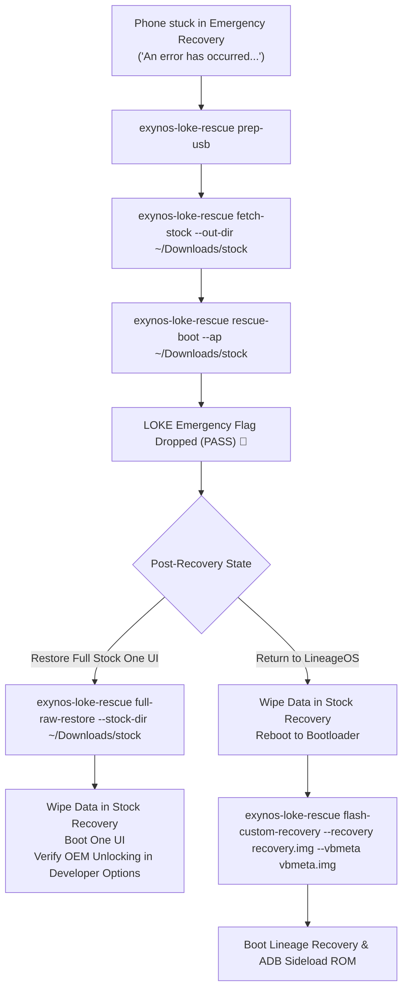

# Exynos LOKE Rescue 📱⚡

[](LICENSE)
[]()
[]()
[]()
[]()
[-blueviolet.svg)]()

> **A Linux-native Rust CLI recovery orchestrator for Samsung Exynos devices—bypasses Heimdall session hangs, Odin4 protocol timeouts, and samloader-rs dynamic super partition crashes.**

---

## 📌 Repository Architecture

```
exynos-loke-rescue/
├── Cargo.toml                      # Rust dependencies & optimized release profile
├── LICENSE                         # MIT License
├── README.md                       # Comprehensive technical blueprint & guide
├── .gitignore                      # Ignores build targets, firmware, and raw images
├── udev/
│   └── 60-samsung-download.rules   # Linux udev rules for Samsung Download Mode (04e8:685d)
├── src/
│   ├── main.rs                     # CLI entrypoint & workflow orchestration
│   ├── cli.rs                      # Clap v4 command-line argument parser & subcommands
│   ├── usb.rs                      # Linux USB sanitizer (ModemManager, cdc_acm, lsusb)
│   ├── archive.rs                  # Zero-disk-waste streaming .tar.md5 & .lz4 decompressor
│   ├── flasher.rs                  # samloader-rs execution orchestrator & live log capture
│   └── diagnostics.rs              # Real-time LOKE & USB error pattern interpreter
├── exynos_rescue.py                # Zero-dependency Python CLI fallback
├── exynos-rescue                   # Python CLI entrypoint executable
└── scripts/                        # Modular standalone Bash shell alternatives
    ├── 01_setup_usb.sh
    ├── 02_extract_img.sh
    ├── 03_flash_signed.sh
    └── 04_flash_stock_os.sh
```

---

## 🔬 Core Technical Problem Matrix (What This Tool Solves)

| Failure Mode | Trigger Condition | Underlying Root Cause | How `exynos-loke-rescue` Bypasses It |
| :--- | :--- | :--- | :--- |
| **`USB bulk read failed (error: -7)`** | Running `Llucs/odin4` on Exynos 850 (`SM-A217F`) or older bootloaders | `odin4` sends Odin v4 session-init packets after the 4-byte `ODIN` handshake; Exynos 850's LOKE bootloader only speaks Odin v3 and drops the pipe after 20s. | Delegates transport exclusively to `samloader-rs` (`nusb` backend) and enforces USB endpoint reset checks between attempts. |
| **`Failed to receive session end confirmation!`** | Running Heimdall v2.2.2 on Exynos 850 | Heimdall uploads partitions via Odin v3, then sends a legacy session-close packet that Exynos 850 ignores, leaving the Emergency Recovery flag (`0x01`) set in `param`. | Uses `samloader-rs` LOKE session termination with cryptographically signed stock binaries to force a clean `Rebooting device...`. |
| **`LOKE returned general failure (FAIL!) [code: -1]`** | Flashing unsigned custom `recovery.img` / `vbmeta.img` while in Emergency Recovery or VaultKeeper (`KG State: Prenormal`) | Samsung `sboot` blocks non-OEM signatures at session close until the device boots stock One UI and syncs VaultKeeper over Wi-Fi. | Automatically detects `code: -1`, warns about VaultKeeper/KG lock, and switches to signed stock `BOOT` + `VBMETA` + `RECOVERY` extraction. |
| **`Dynamic partition pre-flight check failed`** | Flashing `AP_*.tar.md5` + `CSC_*.tar.md5` via `samloader-rs` after LineageOS resized logical partitions | `samloader-rs` parses the phone's scrambled `super` metadata before evaluating `--skip-size-check` or `-e` and aborts with a hardcoded `HOME_CSC` error string. | Streams `super.img.lz4`, `dtbo.img.lz4`, `boot.img.lz4`, `vbmeta.img.lz4`, and `recovery.img.lz4` out of `AP` and flashes them individually via `-p`. |
| **Stale `04e8:685d` endpoint / `cdc_acm` lock** | Aborted flash leaves Linux `cdc_acm` or `ModemManager` holding the interface | `ModemManager` probes Samsung USB serial interfaces (`04e8:685d`), breaking `libusb`/`nusb` interface claims. | Stops `ModemManager`, unloads `cdc_acm`, installs udev rules, and verifies bus re-enumeration via `lsusb`. |

---

## ⚡ Zero-Disk-Waste In-Memory Streaming

Traditional extraction requires unpacking multi-gigabyte `.tar.md5` archives and running standalone `lz4` on 4.5+ GB files, requiring **10+ GB of free disk space** and several minutes of disk I/O.

`exynos-loke-rescue` implements direct in-memory streaming:
* `tar::Archive` iterates the tar entries directly from the archive buffer.
* `lz4_flex::frame::FrameDecoder` decompresses `.img.lz4` frames on the fly as they are read from the tar stream into a buffered writer.
* Cuts extraction time in half and bypasses unpacking the entire archive.

---

## 🛠️ Build & Installation

### Option 1: Rust Binary (Recommended)

#### 1. Install Toolchain & System Dependencies

##### Fedora:
```bash
sudo dnf install -y rust cargo usbutils unzip
```

##### Ubuntu / Debian:
```bash
sudo apt update && sudo apt install -y cargo rustc usbutils unzip
```

##### Arch Linux:
```bash
sudo pacman -S --needed rust cargo usbutils unzip
```

#### 2. Install `samloader-rs`
```bash
curl -s https://api.github.com/repos/topjohnwu/samloader-rs/releases/latest \
  | grep "browser_download_url.*linux.*x86_64" \
  | cut -d '"' -f 4 \
  | xargs curl -L -o samloader-rs.tar.gz

tar -xzf samloader-rs.tar.gz && chmod +x samloader
sudo mv samloader /usr/local/bin/
```

#### 3. Build & Install `exynos-loke-rescue`
```bash
cargo build --release
sudo cp target/release/exynos-loke-rescue /usr/local/bin/
```

---

### Option 2: Zero-Dependency Python Orchestrator

If you do not have Rust installed on your machine, you can run the bundled Python CLI immediately:
```bash
chmod +x exynos-rescue
./exynos-rescue --help
```

---

## 📖 Complete End-to-End Recovery Workflow



### 1. Prepare Linux USB Environment
Sanitize the USB stack, stop ModemManager, unload `cdc_acm`, install udev rules, and verify device enumeration:
```bash
exynos-loke-rescue prep-usb
```

### 2. Auto-Detect & Fetch Matching Stock Firmware
Reads device Model (`SM-A217F`), Bootloader version (`A217FXXUBCVG1`), and CSC (`INS`), querying Samsung FUS servers and downloading the matching signed firmware archive:
```bash
exynos-loke-rescue fetch-stock --out-dir ~/Downloads/stock
```

### 3. Clear Emergency Recovery Screen (Mode 1: Soft-Brick Fix)
Streams only `boot.img`, `vbmeta.img`, and `recovery.img` directly out of the `AP_*.tar.md5` and flashes them to clear the LOKE lock in seconds:
```bash
exynos-loke-rescue rescue-boot --ap ~/Downloads/stock
```

### 4. Full Raw Stock Restore (Mode 2: Bypasses Dynamic Super Partition Crash)
When recovering from LineageOS where dynamic partitions are scrambled:
```bash
exynos-loke-rescue full-raw-restore --stock-dir ~/Downloads/stock
```
1. Phone reboots into Samsung Stock Recovery.
2. Select **Wipe data / factory reset** and select **Reboot system now**.
3. Allow 5–10 minutes for One UI to boot.
4. Enable Developer Options and verify **OEM Unlocking** is active.

### 5. Flash Custom Recovery & Sideload LineageOS
Once OEM Unlocking is active and VaultKeeper is satisfied:
```bash
exynos-loke-rescue flash-custom-recovery \
  --recovery ~/Downloads/recovery.img \
  --vbmeta ~/Downloads/vbmeta.img
```

---

## 🕹️ Hardware Key Combinations (Download Mode)

From a bootloop or frozen screen:
1. Keep the phone plugged into your PC via USB.
2. Hold **Volume Down + Power** simultaneously for **~8 seconds** until the screen goes completely black.
3. **Immediately release both buttons** and hold **Volume Up + Volume Down** together.
4. When the teal Samsung Warning screen appears, press **Volume Up** once.

---

## 📄 License

This project is licensed under the [MIT License](LICENSE).

Copyright (c) 2026 Rabeeh Fouz Ahammad VK.
