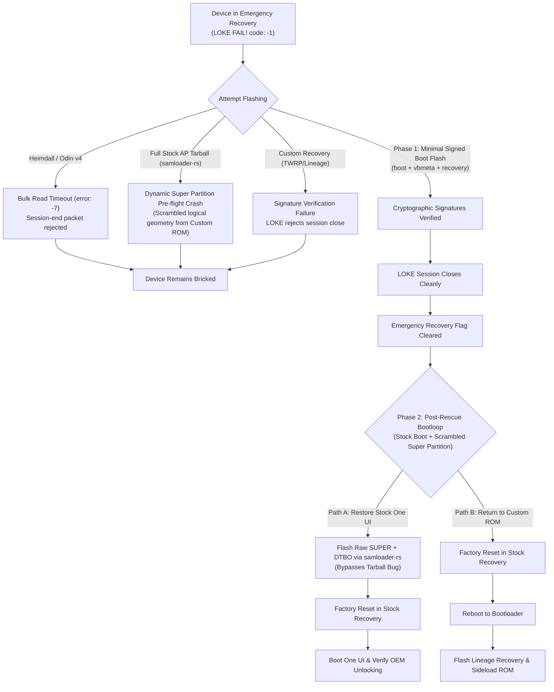

# Exynos LOKE Rescue 📱⚡

[](LICENSE)
[]()
[]()
[]()
[-blueviolet.svg)]()

> **A Linux-native protocol to bypass Heimdall timeouts and samloader-rs dynamic partition crashes to unbrick Samsung Exynos devices.**

---

## 📌 Overview

This repository provides a battle-tested, Linux-native emergency recovery protocol for Samsung Exynos devices (specifically verified on **Exynos 850 / Galaxy A21s `SM-A217F`**) stuck in the notorious emergency recovery loop:

```
An error has occurred while updating the device software.
Use the Smart Switch PC software to emergency recovery function.
```

When transitioning between custom ROMs (such as LineageOS) and stock firmware, standard Linux flashing tools (Heimdall, Llucs/odin4) frequently fail: they either fail to complete the proprietary Samsung LOKE protocol session-close handshake, or abort due to false-positive dynamic partition errors (`insufficient free space in Super partition`).

This project documents and automates:
1. **Phase 1 (Emergency Unbrick):** Using **[samloader-rs](https://github.com/topjohnwu/samloader-rs)** to flash only the cryptographically signed stock boot components (`boot`, `vbmeta`, `recovery`), satisfying bootloader integrity checks and clearing the emergency recovery lock.
2. **Phase 2 (Post-Rescue Decision):** Resolving the subsequent bootloop caused by stock boot images paired with a custom/scrambled dynamic `super` partition, providing tested paths to either **fully restore Samsung One UI** or **jump directly back to LineageOS**.

---

## 🔬 The Root Cause & Protocol Workflow



### Why Standard Linux Tools Fail:
1. **The Heimdall / Odin4 Timeout:** Older and mid-range Exynos bootloaders reject Odin v4 protocol packets, resulting in bulk read timeouts (`error: -7`). While Heimdall uses Odin v3, it fails to send the explicit session-end confirmation packet required by newer Exynos bootloaders (such as Exynos 850).
2. **The LOKE FAIL! `[code: -1]`:** The bootloader locks into an Emergency Recovery state. It rejects session-close attempts whenever custom/unsigned images (like TWRP or Lineage recovery) are uploaded.
3. **The `samloader-rs` Pre-flight Tarball Bug:** Flashing a full stock firmware archive (`AP_*.tar.md5`) directly causes `samloader-rs` to inspect the dynamic partition layout inside `super`. Because custom ROMs repartition the dynamic logical space, `samloader-rs` hits an "insufficient partition space" calculation error and aborts before flashing.
4. **The Bypass Solution:** 
   * Flashing **only** signed `boot.img`, `vbmeta.img`, and `recovery.img` satisfies Samsung's Knox security check and terminates the session cleanly.
   * Flashing **raw** `super.img` and `dtbo.img` directly (rather than passing the AP tarball) bypasses the partition calculation crash completely.

---

## 📂 Repository Structure

```
exynos-loke-rescue/
├── README.md               # Complete documentation and guide
├── LICENSE                 # MIT License
├── .gitignore              # Ignores archives, raw images, and temporary files
└── scripts/
    ├── 01_setup_usb.sh     # Automates ModemManager stop, cdc_acm unload & udev rules
    ├── 02_extract_img.sh   # Extracts boot components or full OS (super/dtbo) with lz4
    ├── 03_flash_signed.sh  # Flashes signed BOOT, VBMETA, and RECOVERY (Phase 1)
    └── 04_flash_stock_os.sh # Flashes raw SUPER and DTBO to restore One UI (Phase 2)
```

---

## 🧰 Prerequisites & Dependencies

- **Operating System:** Any modern Linux distribution (Fedora, Ubuntu, Debian, Arch).
- **Core Utilities:** `bash`, `tar`, `lz4`, `curl`, `udev`.
- **Flasher Utility:** [`samloader-rs`](https://github.com/topjohnwu/samloader-rs) (TopJohnWu's Rust-based Odin protocol implementation).

### Tool Installation

#### Fedora:
```bash
sudo dnf install -y lz4 tar curl
```

#### Ubuntu / Debian:
```bash
sudo apt update && sudo apt install -y lz4 tar curl
```

#### Arch Linux:
```bash
sudo pacman -S --needed lz4 tar curl
```

#### Install `samloader-rs`:
```bash
curl -s https://api.github.com/repos/topjohnwu/samloader-rs/releases/latest \
  | grep "browser_download_url.*linux.*x86_64" \
  | cut -d '"' -f 4 \
  | xargs curl -L -o samloader-rs.tar.gz

tar -xzf samloader-rs.tar.gz && chmod +x samloader
sudo mv samloader /usr/local/bin/
```

---

## 🕹️ Hardware Key Combinations (Download Mode)

When your phone is stuck in an emergency loop or bootloop, use this exact sequence to enter Download Mode:

1. Keep the phone plugged into your PC via USB.
2. Hold **Volume Down + Power** simultaneously for **~8 seconds** until the screen turns completely black (forcing a hard power-off).
3. **Immediately release both buttons** and hold **Volume Up + Volume Down** together.
4. When the teal Samsung Warning screen appears, release all buttons and press **Volume Up** once.
5. You are now in Samsung Download Mode (`04e8:685d`).

---

## ⚡ The Step-by-Step Recovery Protocol

### Phase 1: Unbrick & Clear LOKE Emergency Lock

#### 1. Setup Linux USB Environment
ModemManager and the `cdc_acm` driver frequently lock Samsung's USB endpoints. Run the setup script to configure udev rules and release the ports:
```bash
sudo bash scripts/01_setup_usb.sh
```

#### 2. Download Official Stock Firmware
Fetch the firmware matching your exact model number and CSC (e.g. `SM-A217F` and `INS`):
```bash
mkdir -p stock_fw && cd stock_fw
samloader check-update -m SM-A217F -r INS
samloader download -m SM-A217F -r INS -o stock_firmware.zip
unzip stock_firmware.zip
cd ..
```

#### 3. Extract Signed Boot Components
Extract only the boot components needed to clear the LOKE security lock:
```bash
./scripts/02_extract_img.sh stock_fw/AP_*.tar.md5
```
*(Extracts and decompresses `boot.img.lz4`, `recovery.img.lz4`, and `vbmeta.img.lz4`).*

#### 4. Flash Signed Boot Images
```bash
./scripts/03_flash_signed.sh
```
*Expected terminal output:*
```text
BOOT flash successful [100%]
VBMETA flash successful [100%]
RECOVERY flash successful [100%]
Ending session...
Rebooting device...
```
At this point, the LOKE emergency recovery lock is cleared! 🎉

---

### Phase 2: Resolving the Post-Recovery Bootloop

After completing Phase 1, the phone will bootloop or drop into recovery. This happens because the phone now has official Samsung boot and kernel images, but the underlying `super` partition still has the custom ROM's partition layout.

Choose one of two paths forward:

---

### Path A: Finish Restoring Full Samsung One UI (Recommended)

Restoring full stock One UI is the safest way to cleanly boot the device, connect to Wi-Fi, and verify that **OEM Unlocking** is active before flashing custom software again.

#### 1. Extract `super` and `dtbo` Partitions
Run the extraction script with `--full`:
```bash
./scripts/02_extract_img.sh stock_fw/AP_*.tar.md5 --full
```
*(Or manually run `tar -xf stock_fw/AP_*.tar.md5 super.img.lz4 dtbo.img.lz4 && lz4 -d super.img.lz4 super.img && lz4 -d dtbo.img.lz4 dtbo.img`).*  
> [!NOTE]  
> `super.img` is over 4 GB. Extraction and decompression will take 1–3 minutes.

#### 2. Put the Device in Download Mode
Use the **Volume Down + Power** (~8s) $\rightarrow$ **Volume Up + Volume Down** key sequence with the USB cable connected.

#### 3. Flash Raw SUPER and DTBO
Flash the raw images directly (bypassing the `samloader-rs` AP tarball bug):
```bash
./scripts/04_flash_stock_os.sh
```
*(Or manually run `samloader flash -p SUPER super.img -p DTBO dtbo.img`).*

#### 4. Factory Reset in Stock Recovery
Once flashing finishes, the phone will reboot into **Samsung Stock Recovery** due to leftover user data encryption mismatches:
1. Use Volume buttons to select **Wipe data / factory reset** and press Power to confirm.
2. Select **Reboot system now**.
3. Allow **5 to 10 minutes** for Samsung One UI to complete first-time setup.

#### 5. Verify OEM Unlocking
1. Complete the initial setup wizard and connect to Wi-Fi.
2. Navigate to: **Settings $\rightarrow$ About phone $\rightarrow$ Software information**.
3. Tap **Build number** 7 times to enable Developer options.
4. Go to **Settings $\rightarrow$ Developer options** and confirm that **OEM Unlocking** is visible and toggled **ON**.
5. With OEM Unlocking confirmed active, Samsung's bootloader will no longer reject custom recovery binaries with `FAIL! [code: -1]`.

---

### Path B: Jump Straight Back to LineageOS

If you prefer not to wait for One UI to install:

1. When the device enters **Samsung Stock Recovery** after Phase 1:
   * Select **Wipe data / factory reset** and confirm.
   * Select **Reboot to bootloader** to enter a fresh, clean Download Mode.
2. Flash your chosen custom recovery (e.g. Lineage Recovery):
   ```bash
   samloader flash -p RECOVERY lineage-recovery.img
   ```
3. Boot into Lineage Recovery, select **Apply Update $\rightarrow$ Apply from ADB**, and sideload your custom ROM:
   ```bash
   adb sideload lineage-20.0-*-nightly-a21s-signed.zip
   ```

---

## 💡 What Others in the Community Do

When facing Samsung dynamic partition bugs or Odin protocol quirks on Linux, community members frequently use these alternative methods:

1. **Windows VM with USB Passthrough (GNOME Boxes / VirtualBox):**  
   Instead of debugging Linux USB quirks, developers often spin up a lightweight Windows VM, attach the Samsung USB device (`04e8:685d`), and use the official **Samsung Odin3 v3.14.4** tool. Official Odin natively manages the full four-file flash (`BL`, `AP`, `CP`, `CSC`) without dynamic partition pre-flight crashes.
2. **Thor / Galaxy Flasher:**  
   Some Linux users rely on **[Thor](https://github.com/Samsung-Loke/Thor)**, an open-source C# implementation of the Odin protocol, often used alongside the **Galaxy Flasher** GUI. Thor implements dynamic partition chunking differently than `samloader-rs` and can flash full stock firmware without hitting pre-flight assertion errors.

---

## 🔍 Troubleshooting Matrix

| Issue | Cause | Fix |
| :--- | :--- | :--- |
| `samloader detect` hangs or prints nothing | `ModemManager` or `cdc_acm` kernel module claiming USB endpoints | Run `sudo bash scripts/01_setup_usb.sh` and re-plug USB |
| `bulk read error: -7` (Heimdall) | Odin v4 / v3 protocol handshake mismatch | Use `samloader-rs` instead of Heimdall/odin4 on modern Exynos devices |
| `LOKE FAIL! [code: -1]` | Bootloader rejected unsigned images while in Emergency Recovery state | Run `scripts/03_flash_signed.sh` to flash officially signed `boot`, `vbmeta`, and `recovery` |
| `Pre-flight error: dynamic partition` | `samloader-rs` failed calculating partition geometry from full AP tarball | Flash raw extracted partitions (`-p SUPER super.img -p DTBO dtbo.img`) using `04_flash_stock_os.sh` |
| Bootlooping after flashing signed boot images | Boot components are stock, but `super` partition is still scrambled | Follow **Path A** to flash `super.img` & `dtbo.img`, or **Path B** to wipe and install custom recovery |

---

## 📄 License

This project is licensed under the [MIT License](LICENSE).

---

## ⚠️ Disclaimer

Flashing partitions carries inherent risks. This protocol was tested on a Samsung Galaxy A21s (`SM-A217F`, Exynos 850). Always verify your exact device model and CSC region code before flashing. The authors are not responsible for bricked devices, data loss, or hardware damage.
