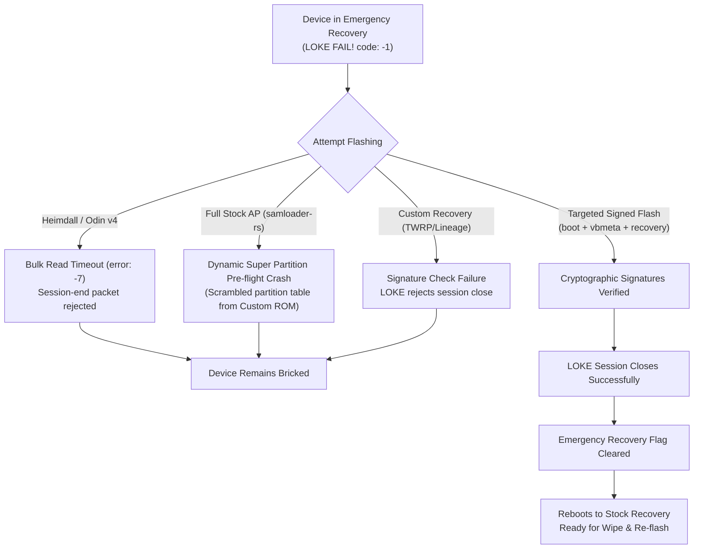

# Exynos LOKE Rescue 📱⚡

[](LICENSE)
[]()
[]()
[]()
[-blueviolet.svg)]()

> **A Linux-native protocol to bypass Heimdall timeouts and samloader-rs dynamic partition crashes to unbrick Samsung Exynos devices.**

---

## 📌 Overview

This repository provides a battle-tested, Linux-native emergency recovery protocol for Samsung Exynos devices (verified on **Exynos 850 / Galaxy A21s `SM-A217F`**) stuck in the dreaded loop:

```
An error has occurred while updating the device software.
Use the Smart Switch PC software to emergency recovery function.
```

When switching between custom ROMs (such as LineageOS) and stock firmware, standard Linux flashing utilities (Heimdall, Llucs/odin4) frequently fail to negotiate the proprietary Samsung LOKE protocol session-close sequence or fail with false-positive dynamic partition allocation errors (`insufficient free space in Super partition`).

This project documents and automates the exact bypass: using **[samloader-rs](https://github.com/topjohnwu/samloader-rs)** to flash **only the cryptographically signed stock boot components**, satisfying the bootloader's integrity verification, closing the LOKE USB session cleanly, and clearing the Emergency Recovery state without triggering dynamic partition metadata crashes.

---

## 🔬 Abstract: The Root Cause



1. **The Heimdall / Odin4 Timeout**: Older and mid-range Exynos bootloaders reject Odin v4 protocol packets, triggering bulk read timeouts (`error: -7`). While Heimdall speaks Odin v3, it fails to transmit the session-end confirmation packet required by modern Exynos bootloaders (e.g. Exynos 850).
2. **The LOKE FAIL! `[code: -1]`**: The bootloader locks into an Emergency Recovery state. It rejects session-close attempts whenever custom/unsigned images (such as unofficial recovery or patched boot) are uploaded.
3. **The samloader-rs Pre-flight Bug**: Flashing a complete stock firmware archive (`AP_*.tar.md5`) fails because `samloader-rs` attempts to parse the dynamic partition metadata inside the `super` partition. Because LineageOS or another custom ROM modified the logical partition geometry, `samloader-rs` hits an "insufficient partition space" pre-flight error and aborts before writing anything.
4. **The Targeted Solution**: Extracting and flashing **ONLY** the officially signed stock `boot.img`, `vbmeta.img`, and `recovery.img` satisfies Samsung's Knox security check, closes the USB session, clears the Emergency Recovery state, and avoids touching the scrambled `super` partition during the flash.

---

## 📂 Repository Structure

```
exynos-loke-rescue/
├── README.md               # Detailed guide and technical documentation
├── LICENSE                 # MIT License
├── .gitignore              # Ignores firmware binaries, .tar.md5, and .img files
└── scripts/
    ├── 01_setup_usb.sh     # Automates ModemManager stop & udev rule configuration
    ├── 02_extract_img.sh   # Automates tar extraction and lz4 decompression
    └── 03_flash_signed.sh  # Automates the samloader-rs signed image flash
```

---

## 🧰 Prerequisites & Dependencies

- **Operating System:** Any modern Linux distribution (Fedora, Ubuntu, Debian, Arch, openSUSE).
- **Core Utilities:** `bash`, `tar`, `lz4`, `curl`, `udev`.
- **Flasher Utility:** [`samloader-rs`](https://github.com/topjohnwu/samloader-rs) (Rust-based CLI for downloading and flashing Samsung firmware via Odin protocol).

### Installation

#### Fedora:
```bash
sudo dnf install -y lz4 tar curl
```

#### Ubuntu / Debian:
```bash
sudo apt update && sudo apt install -y lz4 tar curl
```

#### Arch Linux:
```bash
sudo pacman -S --needed lz4 tar curl
```

#### Install `samloader-rs`:
```bash
curl -s https://api.github.com/repos/topjohnwu/samloader-rs/releases/latest \
  | grep "browser_download_url.*linux.*x86_64" \
  | cut -d '"' -f 4 \
  | xargs curl -L -o samloader-rs.tar.gz

tar -xzf samloader-rs.tar.gz && chmod +x samloader
sudo mv samloader /usr/local/bin/
```

---

## 🚀 Automated Quick Start (Using Scripts)

Clone the repository and run the automated scripts in sequence:

```bash
git clone https://github.com/rebeeh/exynos-loke-rescue.git
cd exynos-loke-rescue
```

### 1. Configure USB Permissions & Stop ModemManager
```bash
sudo bash scripts/01_setup_usb.sh
```

### 2. Download Official Stock Firmware
Fetch the firmware matching your exact model and region (CSC), e.g., `SM-A217F` and `INS`:
```bash
mkdir -p stock_fw && cd stock_fw
samloader check-update -m SM-A217F -r INS
samloader download -m SM-A217F -r INS -o stock_firmware.zip
unzip stock_firmware.zip
cd ..
```

### 3. Extract & Decompress Signed Boot Components
Pass the path to your extracted `AP_*.tar.md5`:
```bash
./scripts/02_extract_img.sh stock_fw/AP_*.tar.md5
```
This extracts `boot.img.lz4`, `recovery.img.lz4`, and `vbmeta.img.lz4` and decompresses them into raw `.img` files.

### 4. Flash Signed Images to Clear the Emergency Lock
```bash
./scripts/03_flash_signed.sh
```

---

## 📖 Manual Step-by-Step Protocol

If you prefer executing each step manually:

### Step 1: Fix USB Permissions & Stop Conflicts
Ensure your Linux machine can access the Samsung Download Mode interface (`04e8:685d` / `04e8:6860`) without ModemManager claiming the interface:

```bash
sudo samloader fix-usb
sudo systemctl stop ModemManager
sudo modprobe -r cdc_acm
samloader detect
```

### Step 2: Download Official Stock Firmware
Download the latest signed official firmware for your device variant:

```bash
mkdir -p ~/stock_fw && cd ~/stock_fw
samloader check-update -m SM-A217F -r INS
samloader download -m SM-A217F -r INS -o stock_firmware.zip
unzip stock_firmware.zip
```

### Step 3: Extract and Decompress Signed Boot Images
Do not attempt to flash the full multi-gigabyte `AP` package directly; doing so triggers the dynamic partition pre-flight crash. Extract only the boot components:

```bash
# Extract lz4 archives from the AP tarball
tar -xf AP_*.tar.md5 boot.img.lz4 recovery.img.lz4 vbmeta.img.lz4

# Decompress to flashable raw images
lz4 -d boot.img.lz4 boot.img
lz4 -d recovery.img.lz4 recovery.img
lz4 -d vbmeta.img.lz4 vbmeta.img
```

### Step 4: Flash Signed Images to Clear the Session
Upload the extracted, signed images. The bootloader validates Samsung's cryptographic signatures, accepts the session-close packet, and clears the Emergency Recovery lock:

```bash
samloader flash -p BOOT boot.img -p VBMETA vbmeta.img -p RECOVERY recovery.img
```

#### Expected Terminal Output:
```text
BOOT flash successful [100%]
VBMETA flash successful [100%]
RECOVERY flash successful [100%]
Ending session...
Rebooting device...
```

### Step 5: Wipe and Proceed
Once the device reboots:
1. Because the dynamic `super` partition contains leftover custom ROM blocks, the device will fail normal boot and automatically enter **Samsung Stock Recovery**.
2. Use the physical volume buttons to navigate to **Wipe data / factory reset** and confirm.
3. Select **Reboot to bootloader** to re-enter a clean Download Mode.
4. Your device is unbricked and ready to accept a fresh custom recovery flash (e.g. Lineage Recovery) and an `adb sideload` of your chosen custom ROM.

---

## 🔍 Troubleshooting

| Issue | Cause | Resolution |
| :--- | :--- | :--- |
| `samloader detect` hangs or prints nothing | ModemManager or `cdc_acm` kernel driver grabbed the tty/USB interface | Run `sudo systemctl stop ModemManager` and `sudo modprobe -r cdc_acm`, then re-plug USB |
| `bulk read error: -7` (Heimdall) | Odin v4 / v3 protocol handshake mismatch | Use `samloader-rs` instead of Heimdall/odin4 on Exynos 850 |
| `LOKE FAIL! [code: -1]` | Bootloader rejected unsigned custom recovery in Emergency Recovery state | Flash only officially signed stock `boot.img`, `vbmeta.img`, and `recovery.img` |
| `Pre-flight error: dynamic partition` | Custom ROM partition layout corrupted metadata expected by full AP flash | Flash individual partitions (`-p BOOT`, `-p VBMETA`, `-p RECOVERY`) rather than the entire AP archive |

---

## 📄 License

This project is licensed under the [MIT License](LICENSE).

---

## ⚠️ Disclaimer

Flashing partitions carries inherent risks. This protocol was tested on a Samsung Galaxy A21s (SM-A217F) Exynos 850 device. Always verify your device model and regional firmware codes (CSC) before flashing. The authors are not responsible for bricked devices, data loss, or hardware damage.
